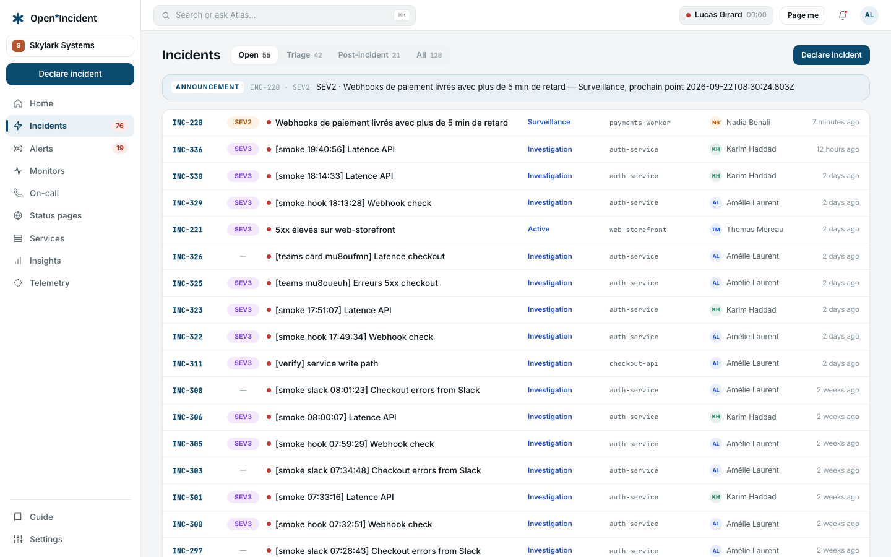
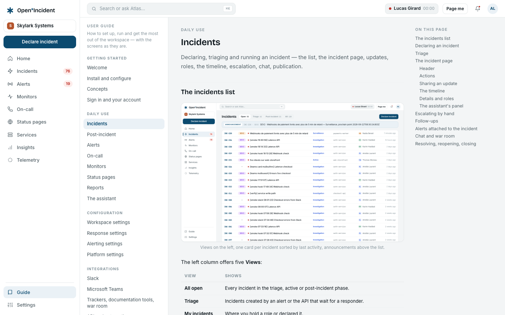

Open Incident is an incident management platform: it takes an alert from your monitoring, wakes the right person, gives the team one place to run the incident, tells customers what is happening, and turns what was learnt into follow-ups and a post-mortem. It is open source (the core is AGPL-3.0) and self-hosted; an enterprise edition adds single sign-on, provisioning and custom roles.

This guide is written for three readers:

- **Operators** who install and run an instance — start with [Install and configure](install) and [Operations](operations).
- **Workspace administrators** who shape the product for their organisation — the [Configuration](settings-workspace) chapters and the [Integrations](slack) chapters.
- **Responders and on-call engineers** who use it every day — [Incidents](incidents), [Alerts](alerts), [On-call](on-call).

The [Use cases](use-cases) chapter walks through complete scenarios, from a Datadog alert at 3 a.m. to the post-mortem exported to Confluence. If you learn by example, start there and come back to the reference chapters when a step needs detail.

## How the product is organised

A signed-in member sees a rail on the left. Each section of it is a chapter of this guide.

| Section          | What lives there                                                                                                                                                                          | Chapter                                                |
| ---------------- | ----------------------------------------------------------------------------------------------------------------------------------------------------------------------------------------- | ------------------------------------------------------ |
| **Home**         | Three steps to a first page while the workspace is empty; then what is burning, the monitors, who is on call, certificates about to expire, the status pages and the services nobody owns | [Welcome](welcome), [Alerts](alerts)                   |
| **Incidents**    | Declaring, triaging and running incidents; follow-ups; the post-incident flow                                                                                                             | [Incidents](incidents), [Post-incident](post-incident) |
| **Alerts**       | What monitoring tools sent, how it was routed, who was paged                                                                                                                              | [Alerts](alerts)                                       |
| **Monitors**     | The checks the product runs itself, and what they do when they fail                                                                                                                       | [Monitors](monitors)                                   |
| **On-call**      | Schedules, overrides, escalation paths, your own notification rules                                                                                                                       | [On-call](on-call)                                     |
| **Status pages** | Public or internal pages, components, maintenances, subscribers                                                                                                                           | [Status pages](status-pages)                           |
| **Services**     | The services your signals name, their owner teams, what watches them                                                                                                                      | [Alerts](alerts), [On-call](on-call)                   |
| **Reports**      | Incidents, alerts, on-call load, follow-ups and on-call pay over a period                                                                                                                 | [Reports](reports)                                     |
| **Telemetry**    | Your own logs, traces, metrics and exceptions, when the module is installed                                                                                                               | [Telemetry](telemetry)                                 |

Under the sections, after a thin line, come **Guide** and **Settings**: one is read once, the other is opened by one person in ten.

The foot of the rail carries the things that are true of you rather than of the screen you are on:

- **Who is on call** right now — "Jordan is on call", the schedule and when the shift ends — with **Page me**, which sends you a real test page through your own notification rules. A toast says how it left ("calling +33 6 •• •• 78", or "email to am…@acme.example"), the header shows **Test mode** while it rings, and the page lands in your bell.
- **You** — your initials, name, role and team. A click opens a menu with **My account** and **Sign out**.

At the top of the rail, under the product name, the workspace chip carries its name; for those who can change it, its caret opens the workspace's address and **Workspace settings**. **Declare incident** sits right below it.

The header holds only two things: the search box — **Search or ask Atlas…**, also <kbd>⌘K</kbd> / <kbd>Ctrl K</kbd> — and the **bell**, with what happened while you were away. The palette goes to any section, declares an incident (<kbd>D</kbd> anywhere outside a field does it too) and sends the test page; every row is reachable with <kbd>↑</kbd> <kbd>↓</kbd> and <kbd>↵</kbd>. A longer query is a question: Atlas does not answer free questions yet and says so, and <kbd>↵</kbd> searches the incidents for it.

A click in the rail replaces the screen and nothing else: the rail, the header and an open menu stay where they were.

## Home

While the workspace has never been paged, **Home** is three steps — **Who should we page?**, **Where do alerts come from?**, **Send a test page** — each done right there and each real; the next one opens once the one before is finished. They are described in [Alerts](alerts#getting-started). Below them:

- **Coming from Opsgenie?** leads to the migration (`/app/settings/migrate`): import people, schedules and policies, check who would be paged without waking anyone, then switch team by team.
- **Run incidents in Slack or Teams** — optional, about two minutes — leads to `/app/settings/chat`.
- **Skip for now → explore the workspace** puts the steps aside for you (in this browser); **Guide → Getting started** brings them back.

Once the chain is proven — someone is paged, alerts have a way in, a test page went out — Home becomes the state of things, and says **You're set.** the first time:

- the **Atlas** banner, when Atlas resolved incidents on its own since yesterday, with **Review** → the incidents list's Atlas tab (`/app/incidents?tab=atlas`);
- **What's burning** — the open incidents with their severity, status and last activity;
- **Monitors** — how many are online, degraded, offline or paused, and eight of them, the worst first;
- **On call now** — who carries each schedule and until when;
- **Certificates** — every certificate monitor, split into valid, expiring within 30 days and within 7 days; the ones expiring soon are listed with their issuer and expiry date, read from the certificate the last check was shown. Under 7 days the monitor is offline and pages the owner of its service;
- **Status pages** — each page's address, what is not operational on it, and its subscribers;
- **Services** — the ones without an owner, when there are any.

The right-hand column drops under the left one on a narrow screen.

## Conventions in this guide

- Screen labels are written **in bold**, exactly as they appear in the English interface: **Alerts → Sources → + New source**. The product is also available in French and German; the labels then follow your language.
- A path like `/app/settings/api` is the address in the browser, relative to your workspace's own address (`https://acme.your-domain.example`).
- `Code` denotes something you type: a command, an environment variable, a JSON body.
- Blockquotes carry notes and warnings:

> A note explains a behaviour that is easy to miss. A warning says what cannot be undone.

## Two principles worth knowing before you start

**Nothing is simulated.** When a capability needs something the instance does not have — an SMS provider, an object storage bucket, an inference provider, an enterprise entitlement — the screen says "unavailable on this instance" and names the variable to set. No button is drawn that does nothing.

**Every change is traced.** Incidents have a timeline; the workspace has an audit log; services, the escalation paths and the status pages version their changes. When something happened, you can find who did it and when.

## The demo workspace

A fresh instance can start with the demo workspace **Skylark Systems** (`SEED_DEMO=true`, the default of `.env.example`): teams, services, an on-call rotation, a reference incident INC-217 with its full history, alerts, a status page. Sign in as `amelie@skylark.dev` with the password `demo-openincident`. Every screenshot of this guide was taken there. Once your own workspace exists, set `SEED_DEMO=false` and remove the demo with the purge command described in [Operations](operations).

The guide you are reading is served by the instance itself: **Guide** in the rail opens **Getting started** — your first page in three steps, at a glance — and every chapter below it, with the images above.

## Where else to look

- `README.md` at the root of the repository: the feature list and the three-command install.
- `CHANGELOG.md`: every capability, in the order it landed, with the reasoning behind it.
- `/api/v1/openapi.json` on your instance: the API contract, served by the instance itself.
- `CONTRIBUTING.md`: the development setup and the conventions of the code base.
