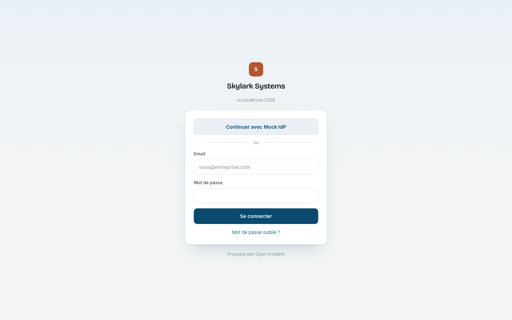
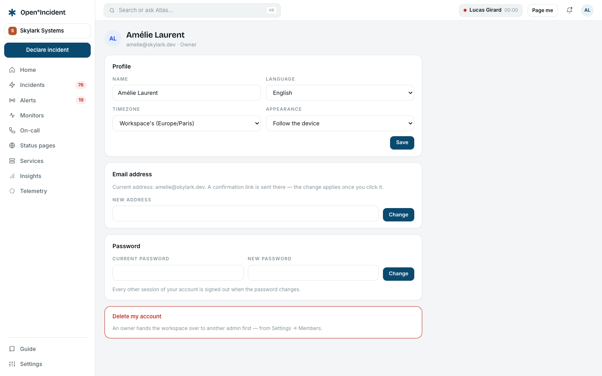
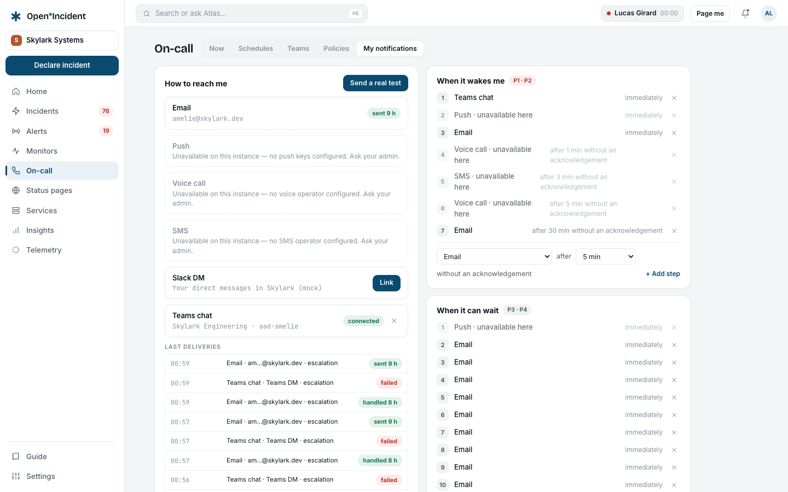

## Joining a workspace

You enter a workspace in one of three ways:

1. **An invitation.** An administrator invites your email from **Settings → Members & access**. You receive an email with a link valid for seven days; the page asks for your name and a password, creates your account and signs you in. If you already have an account on the instance (from another workspace), the same link simply adds the membership.
2. **Single sign-on** (enterprise edition). The sign-in page shows a **Continue with …** button per connection; your identity provider signs you in, and a member is created on the spot with the role the connection gives to newcomers.
3. **Provisioning** (enterprise edition). Your identity provider created the member through SCIM; you then sign in through SSO, or through the invitation email the provisioning sent.

## Signing in

Go to your workspace's address (`https://acme.your-domain.example`, or the bare domain on a single-workspace instance). The page shows the workspace's name and its address — the two details that distinguish it from a copy of it.

- **Email and password** is always available, unless the workspace enforces single sign-on for your email domain.
- **Continue with Google / Microsoft / GitHub** appears when the operator configured that provider on the instance.
- **Forgot your password?** sends a link valid for one hour. Setting a new password signs out every other session of your account — the recovery move after a possible compromise.

The sign-in endpoint is rate limited: after a burst of attempts you are told to wait ten seconds. This is not a wrong password.

> A viewer signs in like anyone else and reads everything; only the controls that act are absent for them.

## My account

Click your name at the foot of the rail and choose **My account**. **Sign out** is in the same menu: it ends the session on the server and returns to the sign-in page — the only way out for a member who signs in through single sign-on and has no password.

| Setting               | What it does                                                                                                                                                                                                  |
| --------------------- | ------------------------------------------------------------------------------------------------------------------------------------------------------------------------------------------------------------- |
| **Name**              | How you appear in timelines, in chat channels and in emails.                                                                                                                                                  |
| **Language**          | English, French or German. By default you follow the workspace's language; an override is yours alone.                                                                                                        |
| **Timezone**          | Times on screen — and your on-call shifts — are shown in it. By default the workspace's.                                                                                                                      |
| **Appearance**        | Follow the device, light or dark. Every design token has a dark value; the choice is stamped before the first paint, so nothing flashes.                                                                      |
| **Email address**     | A confirmation link goes to the _new_ address; the change applies once you open it.                                                                                                                           |
| **Password**          | Changing it signs out every other session.                                                                                                                                                                    |
| **Delete my account** | Removes your sign-in identity after a confirmation link (valid one hour). What you did stays attributed to your name in the timelines — the audit trail requires it. An owner hands the workspace over first. |

## Your notifications

**On-call → My notifications** is where you decide how the product reaches you when you are paged.

### How to reach me

The card lists what can reach you, then — dashed, with the reason — what this instance cannot use. Each row carries the status of its last real delivery (_queued_, _sent_, _delivered_, _failed_), or _linked_ / _verified_ when nothing went out yet.

- **Slack — direct message** and **Microsoft Teams — chat** appear when the workspace connected Slack or Teams and offers pages in chat (**Settings → Slack & Teams**): click **Link** (the product finds your account by email) and pages arrive as a direct message with an **Acknowledge** button that acknowledges the page.
- **Push** is enabled per browser: click **Enable on this browser**, accept the browser's prompt. It wakes the screen even when the tab is closed. Needs VAPID keys on the instance.
- **Voice call** and **SMS** need a phone number in international format (`+33…`). A code is sent; enter it to verify. Each needs its own operator configured on the instance — one can be available without the other.
- **Email** is always there: your account address.

### Two rules, by urgency

- **When it wakes me (P1 · P2)**: the steps used, in order, for an urgent page. Steps that go out at the same moment share a line — by default _Slack message + Push_ immediately, then a _Voice call_ after one minute without acknowledgement, then a second call (_retry_) at four.
- **When it can wait (P3 · P4)**: by default _Slack message + Push · silent_ immediately — the push lands without ringing — and the **Email digest** at 09:00 in your timezone: every low-urgency page of the night in one message.

**+ Add step** adds a channel at a delay; hovering a line shows its **✕**. A channel you cannot use yet is struck through; when nothing in a rule can reach you on this instance, the card says that your pages go to your email instead.

### Test it

**Send a real test** sends a real message through every channel of your high-urgency rule; the banner names the channels on their way, and the statuses on the rows follow the deliveries.

### When Atlas resolves on its own

On services at level 4 nobody is paged when Atlas resolves an incident by itself. The card lets you choose how you hear about it: a silent push right away, a summary at 09:00, or nothing (review in **Incidents → Resolved by Atlas**). Level 3 still pages you when Atlas acts.

### Shift reminders

Tick **Warn me before my shift starts** and **Warn me when my shift ends** to be told when a rotation puts you on or off call.

## Acknowledging a page

A page reaches you with a one-tap link (email, SMS, push) or a button (Slack, Teams, voice: press **4**). Acknowledging stops the escalation timers, tells the team you are on it and, when the page came from an incident, adds you to the incident. The same **Acknowledge** button is on the alert's page in the product.
