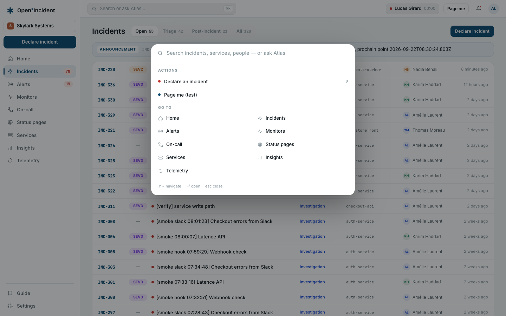
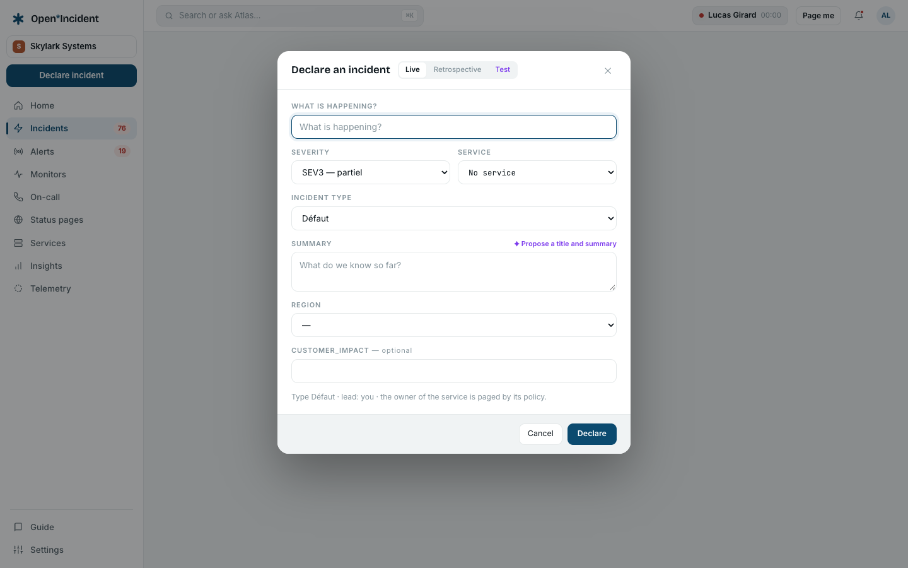
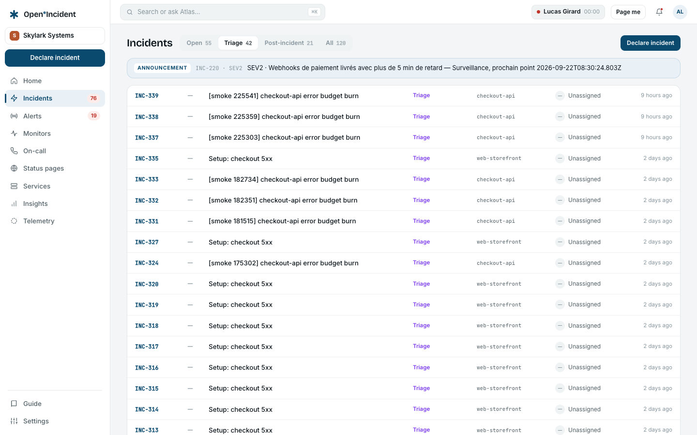
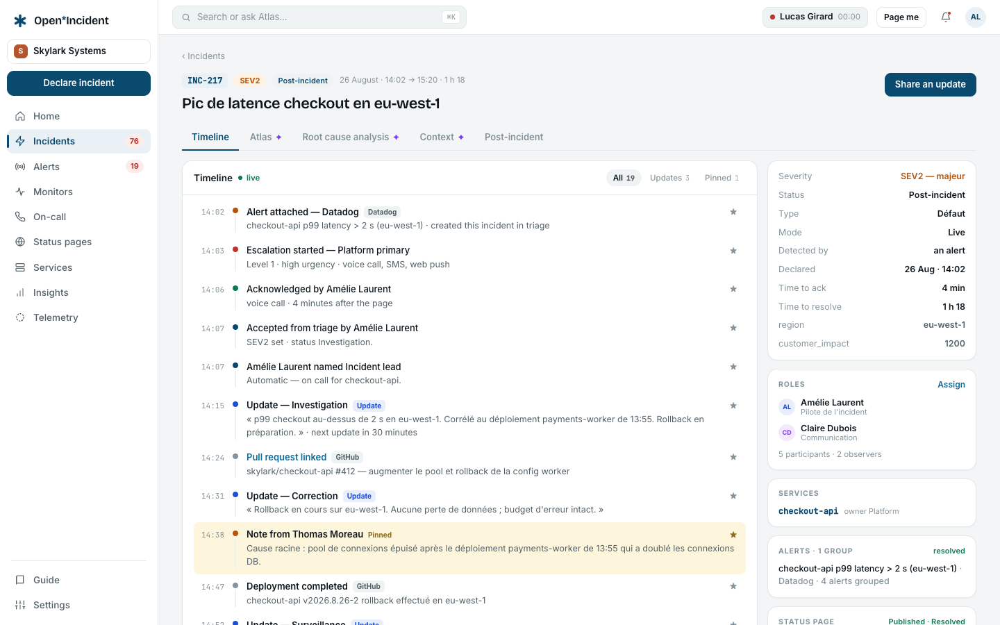
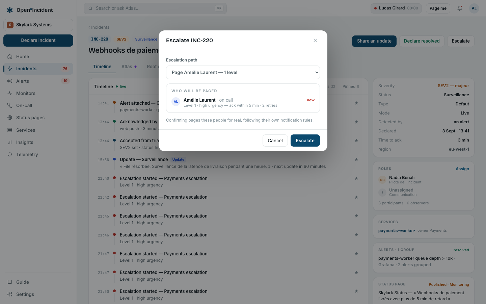
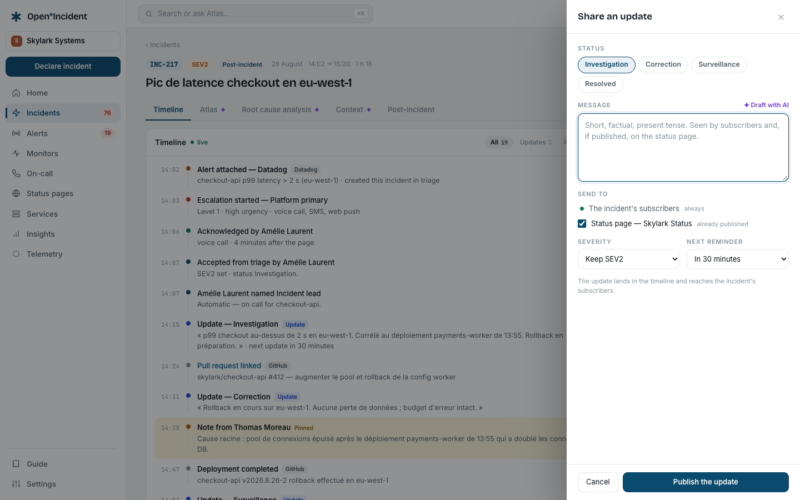
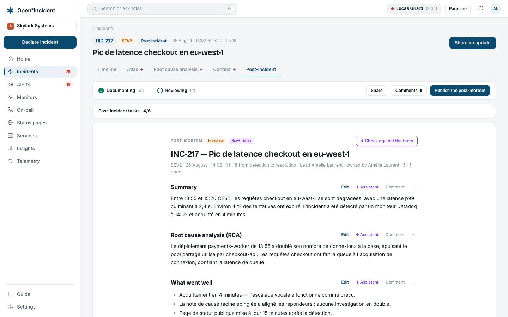

## The incidents list

The list has five tabs, each with its count. The address carries the tab (`?tab=atlas`, `?tab=triage`…), so a link opens the right one.

| Tab                     | Shows                                                                                                                                                                                               |
| ----------------------- | --------------------------------------------------------------------------------------------------------------------------------------------------------------------------------------------------- |
| **✦ Resolved by Atlas** | The incidents Atlas resolved on its own and nobody has reviewed yet — one card each, with what it did, Undo per reversible step, and **Looks right**, **Not quite** or **Reopen**. See [Atlas](ai). |
| **Open**                | Incidents being worked on.                                                                                                                                                                          |
| **Triage**              | Incidents created by an alert or the API that wait for a responder.                                                                                                                                 |
| **Post-incident**       | Resolved incidents whose post-incident flow is running.                                                                                                                                             |
| **All**                 | Everything above, and what was closed in the last seven days. Older incidents are in the reports.                                                                                                   |

Each row reads: the reference (`INC-217`), the severity, the title (a red dot while it is live, **Private** when it is), the status, the service, the lead and the last activity — minutes within the hour, the time of day today, the date before that. The status is coloured by where it sits in the type's lifecycle: triage amber, the first status red, the middle ones violet, the last one green, post-incident blue.

Every open follow-up of the workspace is one address away: `/app/incidents?view=follow-ups`.

Press <kbd>⌘K</kbd> / <kbd>Ctrl K</kbd> anywhere to open the **command palette**: search incidents, services and people; jump to a screen; declare an incident; share an update on the incident you are viewing.

## Declaring an incident

**Declare incident** in the list or the rail, or <kbd>⌘K</kbd> → _Declare an incident_.

1. **Live**, **Retrospective** or **Test**, in the dialog's header — _Retrospective_ records something that already happened (you set when it started); _Test_ is a drill, excluded from reports, announcements and status pages.
2. **What is happening?** — one line. As you type, the product looks for an open incident with a similar title and offers to **Join** it instead of opening a duplicate.
3. **Severity** and **Service** — the severity decides who is announced to, whether a status page suggests publication and whether the post-incident flow starts at resolution; the service binds the incident to its owner team and to the status page components bound to it.
4. The line under them says what declaring sets: the **type** (a menu when the workspace has several — each type carries its own lifecycle and form), **lead: you**, and who owns the service.
5. Fields the type requires are asked right away. Its optional ones — a summary, the workspace's labels — wait behind **+ N more fields** at the bottom left. With Atlas available, **Propose a title and summary** sits on the summary.

**Declare** opens the incident in the active phase, with the type's first status and you as lead. When Slack or Teams is connected with automatic channels, a channel is created; when a war-room template is set, the video link is attached.

> A responder or above declares. A viewer does not see the button and cannot reach the form.

## Triage

Incidents that come from an alert route set to _conditional_, or from the API, start in **Triage**: nobody is paged, no status page suggested, until a responder decides.

- **Accept** sets a severity and the type's first active status; the escalation configured by the route starts now.
- **Decline** with a reason (required) closes the incident; the reason is traced.
- **Merge** attaches it to another open incident: alerts and timeline events follow, and the merged incident points at its target.

## The incident page

The reference, the severity and status chips, the window (`26 Aug · 14:02 → 15:20 · 1 h 18`) and the title. Then the tabs, each with its own address (`?tab=`): **Timeline**, **Atlas ✦**, **Root cause analysis ✦**, **Context ✦**, **Post-incident**. Atlas's tabs are described in [Atlas](ai); the post-incident one in [Post-incident](post-incident).

### Actions

| Action               | What it does                                                                                                       |
| -------------------- | ------------------------------------------------------------------------------------------------------------------ |
| **Share update**     | The main gesture: a new status, a message, where it goes, the next reminder (see below).                           |
| **Escalate**         | Pages people through an escalation path, with a preview of who is on call right now. Until the incident is closed. |
| **Publish**          | The same drawer with the status page ticked — when the incident meets the page's threshold or is already on it.    |
| **Declare resolved** | The same drawer with **Resolved** chosen: a resolution still says why. While the incident is active.               |

### Sharing an update

- **Status** — one of the type's statuses, or **Resolved**. Resolving ends the active phase; if the severity asks for it, the post-incident flow starts.
- **Message** — short, factual, present tense. **✦ Draft with Atlas** drafts it from what happened since the last update, labelled until you edit it.
- **Send to** — one switch per destination: the **internal subscribers** (the people on the incident, told in their bell), the **status page** (nothing is published on it without this tick), the incident's **Slack** channel, its **Teams** channel. The timeline line of the update keeps where it went.
- **Remind me for the next update** — in 30, 15 or 60 minutes, or no reminder. When the reminder falls due without an update, the lead is reminded and the timeline says _Update overdue_.

### The timeline

Live over server-sent events: new events appear without a reload (the **live** dot is green while the stream is open). The filters count what they filter: **All**, **✦ By Atlas**, **Updates**, **Pinned**.

Updates, notes and what Atlas did carry their text under the line; the moves of the incident itself — an alert attached, a page, an acknowledgement, an acceptance, a resolution — are one line, their detail on hover. Every event says who did what: declared, accepted from triage, roles named, updates (with where they went), severity and status changes, notes, decisions, alerts attached, pages and acknowledgements, links and pull requests, deployments, follow-ups, publication on a status page, merges, reopenings.

**What Atlas did** is in the same timeline, marked **✦ Atlas**: what it started, suggested, proposed, ran and verified, and the approvals people gave. A reversible action it ran has an inline **Undo**; undoing writes its own line, and **Redo** puts it back.

The field at the bottom adds a **note** — <kbd>Enter</kbd> or <kbd>⌘↵</kbd> posts it. **Pin** any line (the 📌 that appears on hover) to bring it into the **Pinned** filter — the short version of the story for whoever joins now. In Slack, a :pushpin: reaction on a message pins it to the timeline as a note.

### The right column

- **The facts** — severity (change it right there: pick another level and it is saved, with a line in the timeline), status, type, mode when not live, what detected it (the alert's source and severity), time to acknowledge, time to resolve, and the incident's labels.
- **Roles** — the lead and the other roles with their holders (**Assign** names one), then who the page reached: the first responder who acknowledged, or the people being paged right now.
- **Services** — the incident's services with their owner team, or _no owner_.
- **Alerts** — the alert groups behind it, their source and how many were grouped, and whether they are still firing.
- **Channels** — the incident's Slack channel (with its members, when Slack answers) and Teams channel, each with **Open in Slack** / **Open in Teams**, the war-room link, and one line: the pinned header kept current, the messages in the channel, the ones pinned to the timeline with 📌. **Settings** leads to Settings › Slack & Teams. With no chat connected, the card says so.
- **Status page** — what the public page carries (« its title » and the number of public updates), or how to publish.
- **Follow-ups** — the incident's follow-ups, open first, and **Post-mortem →**.

## Escalating by hand

**Escalate** opens the dialog: choose a published escalation path and read **Who will be paged** — level by level, the members on call right now with their urgency, acknowledgement window and retries. _This path reaches nobody right now — check the schedule_ is said before you confirm, never after. Confirming pages these people for real, following their own notification rules. Who is being paged, then who acknowledged, appears in the **Roles** card, and the page in the timeline.

## Follow-ups

The follow-ups — what has to be done after the incident — sit at the end of the post-mortem, in the **Post-incident** tab: a title, a **priority** (with the workspace's closure policy), an owner, a deadline, the tracker issue. **+ New follow-up** adds one; the box ticks it done.

**Export** (on hover) sends a follow-up to a connected tracker (GitHub Issues, GitLab Issues, Jira, Linear); the line keeps the link, and a closed issue marks the follow-up done here with a line in the timeline. See [Trackers and documentation tools](trackers-docs).

## Alerts attached to the incident

An incident opened from an alert keeps it: the **Alerts** card lists the groups with their state, and the alert's own page points back (see [Alerts](alerts)). An alert resolved at the source is written in the timeline; whether that ends the escalation is decided by the route.

## Chat and war room

With Slack or Teams connected, the incident has a channel: a header card kept current (severity, status, lead, next update), every update mirrored when its switch is on, notes from the channel pinned to the timeline, and — in Slack — a :white_check_mark: reaction that turns a message into a follow-up. Announcement rules post to the channels they name. The commands are described in [Slack](slack) and [Microsoft Teams](teams).

## Resolving, reopening, closing

**Declare resolved** (or the **Resolved** status of an update) resolves the incident: the time to resolve is fixed, subscribers are told, the status page (if published) shows _Resolved_, the announcement closes. If the severity asks for it, the **post-incident** phase starts (see [Post-incident](post-incident)); otherwise the incident is **closed**. A closed incident can be reopened for 30 days; the reopening is an event like any other.
