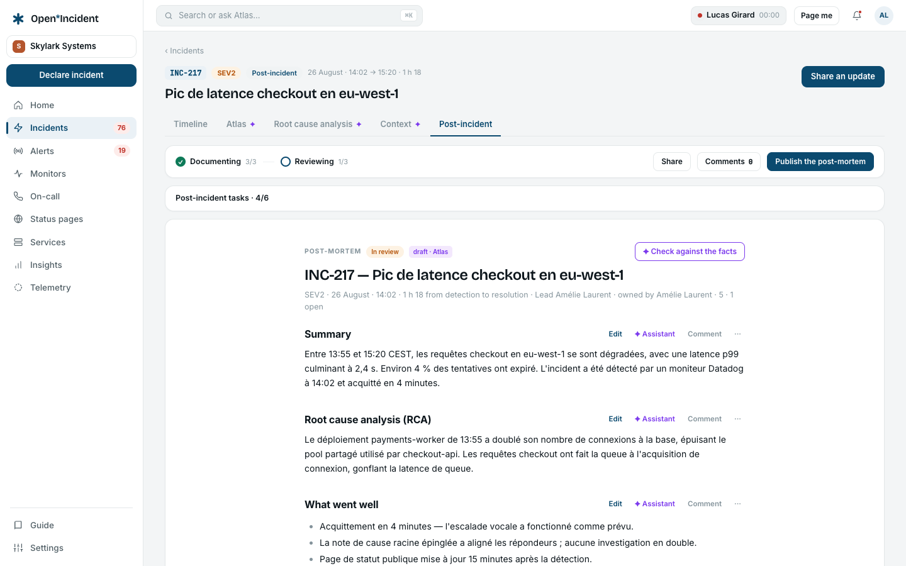

## When the flow starts

The **Post-incident** tab of an incident becomes active when the incident is resolved and its severity asks for the flow. Each severity says, in **Settings → Types, severities & fields → Severities**, whether it starts the flow: _always_, _yes_, _opt-in at closure_, or _no_. The timeline records _The post-incident flow starts (SEV2 rule)_.

## Three phases, their tasks

One strip runs above the document: **Documenting**, **Reviewing**, then **Learning**, each with how many of its tasks are done. Click a phase to see its tasks and tick them.

The first two phases hold the tasks configured in **Settings → Types & lifecycle → Post-incident**: write the timeline of events, identify contributing factors, schedule the debrief, review the follow-ups… Each task has a default assignee (the incident lead, the communication lead, or nobody) and a deadline counted in days after entering the phase. A task is **done** with a click, or **skipped with a reason** — the skip is traced in the timeline. **Learning** is the document reaching the team: its one step, _Share the post-mortem_, is done when the post-mortem is published. The incident leaves the post-incident phase and **closes** when every task is done or skipped.

The same strip shows who else has the document open right now (**N reading now**), **Share** (copies the document's address), **Comments** with the number of open ones, and the next step of the document — **Send to review**, then **Publish post-mortem**.

> Tasks are copied into the incident when it enters the flow. Changing the flow's definition later affects the next incidents, never the ones already in it.

## The debrief

Scheduling a debrief sets a date and a slot and sends an invitation to the guests — the role holders and the active participants. The timeline says _debrief scheduled on …_, and the **Reviewing** phase shows it.

## The post-mortem

The workspace calls it what it likes — the term is configured in **Settings → Types & lifecycle → Post-incident** and used everywhere. It is a document, edited where the incident lives, read at a 780 px column like a page.

### The document

At the top: the term, the status (**In progress**, **In review**, **Completed**), **generated by Atlas · edited by N people** when Atlas wrote the first draft, the **title** (click to rename) and one line of metadata — severity, the window and its duration, the owner, the follow-ups and how many are open.

Then the **sections**, one after the other. A new document starts from the workspace's **template** (**Settings → Types & lifecycle → Post-incident → Post-mortem template**): by default six sections — **Summary**, **Impact**, **Timeline**, **Root cause analysis (RCA)**, **What went well**, **What to improve** — each with a hint of what it should hold. A section Atlas wrote that nobody has edited since reads **draft · Atlas**; the root cause written from Atlas's analysis carries a violet rule and the way back to the **Root cause analysis** tab.

Three blocks follow, read off the incident rather than typed:

- **Decisions** — the decisions taken during the incident, with their time, who took them and why. **+ Add a decision** records one; it is a line of the timeline too, tagged _Decision_.
- **What Atlas did** — when Atlas acted on the incident: what it started, proposed and ran, who approved what, the grade, the cost, what was undone, and what one more level of autonomy would have gained. Written from Atlas's journal.
- **Follow-ups** — one line each: the priority, the status, the owner, the tracker issue; the box ticks it done, **Export** (on hover) sends it to a tracker, **+ New follow-up** adds one.

The footer says how the document was made and offers **Export PDF**; the **···** next to it holds the other exports.

### Writing

Each section shows one control, **＋ Comment**; its editing tools appear when the pointer is on it. **Edit** opens the section in **Markdown**, with a toolbar — bold, italic, heading, lists, quote, code, link — and a **preview**. Three blocks insert what the incident already knows, at the cursor: the **timeline** (the key events with their times), the **follow-ups** (as a table) and the **impact metrics**. `⌘↵` saves. The **···** menu renames a section or moves it up or down; a section a person added can be removed (the template's own stay, empty them instead). **+ Add a section** at the end adds one of the document's own.

### Comments and notes of the team

**＋ Comment** under any section — a typed one, Decisions, What Atlas did, Follow-ups — opens a field: <kbd>⌘↵</kbd> posts. The comment shows under the section at once, with who wrote it and when, and stays until someone **Resolves** it. Comments can be left at any time, on a document Atlas wrote entirely as well; naming someone with `@` tells them in their bell.

**Comments** in the strip opens the panel on the right: every comment of the team, the section it is on, the resolved ones with who resolved them. Comments stay with the incident — they never appear on the status page, in the exported post-mortem or on the published page. At the bottom of the panel, the document's **activity**: every change — an edit, a draft, a section moved, a title — with who and when; **Restore** brings an earlier version back, itself recorded, so nothing is ever lost.

### Drafting with Atlas, section by section

With an inference provider configured and the capability allowed in **Settings → AI assistant**, Atlas works on the document — one section at a time when you ask for one, so you pay for what you asked:

- **Draft with Atlas** fills every empty section from the incident's timeline, the updates and the analysis. Each section reads **draft · Atlas** until a person edits it.
- The **✦** menu of a section: **Generate / Regenerate** this section from the timeline; **Tighten** (half the length, every fact kept); **Enrich with facts from the timeline** (times, actors, numbers the section lacks — nothing the material does not say); **Rewrite for a reader who was not there**.
- **✦ Check against the facts**, in the footer, reads the whole document once and compares each section with the timeline, the alerts and the changes. It leaves a badge per section — **Gap** (a fact the section should state), **Contradicts the facts** (with what the material says instead), or nothing when supported — and a summary line. It changes no text: the badges say where to look.
- When the incident's [root cause analysis](ai#root-cause-analysis-rca) has a surviving hypothesis, accepting it in the **Root cause analysis** tab writes it into the **Root cause analysis (RCA)** section while that section is still empty.

The prompt is redacted before it leaves (emails, phone numbers, IPs, hostnames, secrets). Read every section before sharing.

### Status

Its status moves by hand: **In progress** → **Send to review** → **In review** → **Publish post-mortem** → **Completed**. Publication is an event in the timeline and completes the **Learning** phase.

### Every post-mortem in one place

**Post-mortems** lists every incident that reached the post-incident phase: the document's status, owner, last update, open follow-ups and open comments, filtered by status — including the incidents whose document has **not started**.

## Exporting the post-mortem

**Export PDF** opens the document alone, at its reading width and without the team's comments, and hands it to the browser's print dialog — save it as PDF there. The **···** next to it offers **Download as Markdown** (a `.md` file), **Copy as Markdown** (to the clipboard) and **Open as a page** — the same document, to share by link. `GET /api/v1/incidents/{ref}/post-mortem` returns the same document as sections and as markdown, for a knowledge base or a tool of your own.

When Confluence or Notion is connected in **Settings → Integrations**, the **···** menu shows **Export to Confluence** / **Export to Notion**. The written sections become a page — Confluence storage format in the configured space, or Notion blocks under the configured parent page — with a link back to the incident. The page's address stays on the post-mortem (**Exported page**) and in the timeline. Exporting again creates a new page; nothing there is overwritten. The post-mortem here stays the source.

At least one section must be written before exporting; an empty post-mortem is refused with a message, not exported blank.

## Follow-ups after the incident

The document's **Follow-ups** and the follow-ups view of the incidents list (`/app/incidents?view=follow-ups`) carry the actions the post-mortem calls for. The closure policy (P1 follow-ups closed within _n_ days) is shown above the list, and the **Reports → Follow-ups** tab measures closure by team against it. Exporting to a tracker keeps the status in sync: a closed issue marks the follow-up done here.
