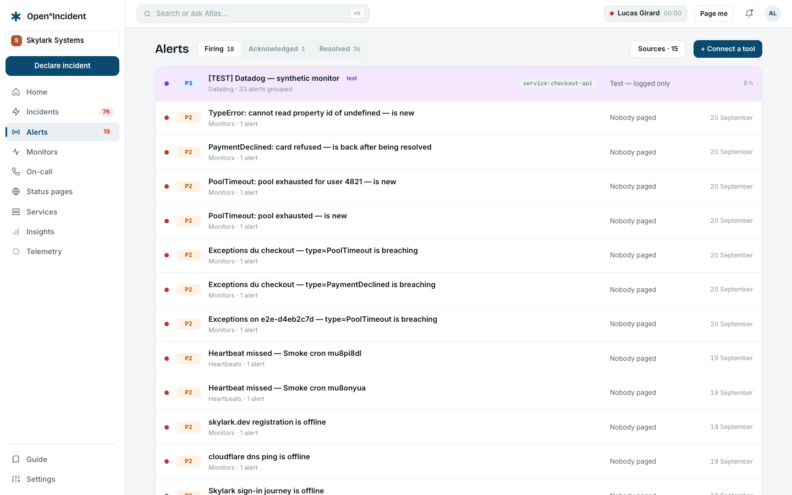
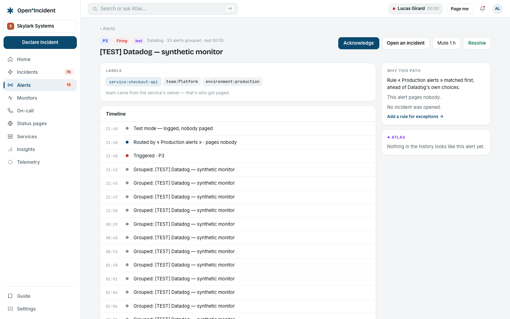

## Getting started

The welcome screen — **Home**, until the workspace has had its first page — takes a workspace from nothing to "an alert paged someone" in three steps, each of them real:

1. **Who should we page?** You, a teammate, or a schedule. With **Me**, verify your phone with a code sent by SMS (on an instance without an SMS or voice operator the card says your email is the pager instead); **Continue to alerts** then publishes an escalation path that pages you and names it on the rule that catches every alert. **+ Add a backup** invites a colleague and adds them as the path's second level, five minutes after you. **A teammate** invites someone by email and pages them; they verify their own phone from the invitation. Refine the path later — levels, retries, working hours — in **On-call → Policies**.
2. **Where do alerts come from?** Pick the tool in the grid and **Create the source**: it is named after the tool, pages you, opens an incident from P2 and resolves itself, and its URL — secret included, shown once — is there to paste in the tool. Or type a URL in **We watch a URL for you**: **Continue to the test** creates a [monitor](monitors) that checks it every minute.
3. **Send a test page.** A real page marked _test_, through your own notification rules, right now. The card follows it out channel by channel — on its way, sent, failed — and **I acknowledged on my phone** brings Home to the living workspace.

Nothing has to be declared first. Services appear on their own, the moment an alert or a monitor names one; giving one an owner team in **Services** is what later lets a source page _the team that owns the service_ rather than a fixed path.

If no tool is sending anything yet — or if what you want watched is a URL, a certificate, a purchase flow or a query over your own logs — the product can produce the alert itself. See [Monitors](monitors): a monitor posts to this same pipeline through a managed source, so everything in this chapter applies to it unchanged.

## From a webhook to an alert

Every monitoring tool posts to its own **alert source**: one endpoint and one secret per source (Datadog, Prometheus/Alertmanager, Grafana, Sentry, CloudWatch, Uptime Kuma, generic HTTP). The secret travels in the `x-oi-secret` header or as `?secret=` in the URL; a JSON body is read as JSON whatever content type the tool labelled it with, so `curl -d '{…}'` works as-is. The payload is stored raw and parsed into the workspace's **labels** — service, team, environment, region, the tool's own severity, and any you add in **Settings → Labels**. A label typed `service` or `team` is resolved against the workspace's real services and teams — an unknown service name is recorded as a new one, seen in traffic, and the team is derived from the service's owner when the payload gives none. The source then decides the **alert severity** (P1–P4) — the same for every alert, or read from a payload field with a value map; a word the tools use (_critical_, _warning_) matches a severity by its aliases — and may **filter** out what it does not want (resolutions always pass).

Two mechanisms keep the noise down before anything else happens:

- **Deduplication by key**: the same key from the same source is one alert with more events, not a new alert.
- **Grouping**: alerts from the same source and service within the grouping window (5 minutes by default) are handled as one; the ones that join are counted on the first and page again only if the rule says so.

Then the decision. **Rules** (Settings → Rules) are the exceptions: they are tried in order and the first whose conditions hold decides. Without a matching rule, **the source's own three choices** apply:

| Choice               | Answers                                                                                                    |
| -------------------- | ---------------------------------------------------------------------------------------------------------- |
| **Who to page**      | The service owner (the team that owns the service named in the alert), you, a team, a schedule, or nobody. |
| **Open an incident** | _Yes, in triage_ for every alert; _From P2_ or _From P1_ — only from that severity up; or _Never_.         |
| **Auto-resolve**     | Whether the tool saying "recovered" closes the alert and stops its escalation.                             |

If the service named in the alert has an owner, the owner is paged instead of the source's fallback.

## The alerts list

Three tabs — **Firing** (nobody has taken it), **Acknowledged**, **Resolved** — each a deep link (`/app/alerts?tab=resolved`). A row says, in one line, what a responder asks first: the severity, the title, the source and how many alerts were grouped under it, the service, **who is being paged** (_Paging Jordan_, _Waits for 09:00_ when the path waits for working hours, _Acked by you_, _Auto-resolved_, _INC-217 resolved_), and when it last fired. The dot pulses while somebody is being paged for it.

When Atlas took an alert, the row says so in violet: **✦ Atlas on it** while it works, **✦ by Atlas alone** or **✦ by Atlas · Thomas told** once it resolved the incident — the latter when the service's level asks Atlas to tell somebody after the fact. See [Atlas](atlas).

## An alert

Under the title, when Atlas is working on the alert, a violet line says what it is doing and why it asks before acting — for instance, a fix that has never been used on this service — with **Approve the fix**.

### The gestures

| Gesture           | Effect                                                                                                                                                                                                                    |
| ----------------- | ------------------------------------------------------------------------------------------------------------------------------------------------------------------------------------------------------------------------- |
| **Acknowledge**   | Stops the escalation timers and tells the team you are on it. **Undo** sits on the acknowledged card. Acknowledging from a page (email link, SMS link, push, Slack or Teams button, voice key **4**) is the same gesture. |
| **Open incident** | Opens the incident the alert created or joined — or declares one from the alert, with its title and service.                                                                                                              |
| **Mute 1 h**      | Defers the notifications; the alert stays firing.                                                                                                                                                                         |
| **Resolve**       | Ends the alert and its escalation. A resolution from the source does the same when the source auto-resolves.                                                                                                              |

### Who is paged, and why

While an escalation runs, the red card says who is being paged, on which path and level, how (push then a call, or a notification without ringing), and who comes next if nobody acknowledges — with the countdown: _Karim after 4:46 without ack_. Once somebody acknowledges, the card turns green and says by whom.

**Why this path** says, in one sentence, who decided: the rule that matched first, or the source's own choice (_Source Datadog says: page the service owner. auth-service is owned by Platform → « Platform primary ». No rule matched._). **Add a rule for exceptions →** opens the rules.

### Timeline, labels and payload

The **timeline** is the alert's own record: fired with its severity, who the path paged and through which owner, the incident opened, each level notified and how, the alerts grouped under it, acknowledged by whom, muted, resolved by whom or at the source, test mode. A line at its foot takes a note — what was checked, why it was resolved, a hand-over — without opening an incident.

**Labels** are the ones the pipeline bound, the service first (it links to the service); when the team came from the service's owner, the card says so. The **payload** is kept exactly as received — **show raw**.

The **✦ Atlas** card shows the most similar past incident (never the alert's own), with a link to it — or says that Atlas is not configured on this instance.

## Alert sources

**Alerts → Sources** shows one card per source: its three choices, and how it is doing — **Receiving** (with today's last alert), **Quiet 12 d** with where to look (_check the SNS subscription_), **Test mode**, **Paused**, or waiting for its first alert.

### Connecting a tool

**+ Connect a tool** asks two things: which tool (or **Migrate** — coming from Opsgenie is a [migration](settings-alerting), not a source), then its name and its three choices. **Create source** shows the endpoint with its secret **once** — the secret is never stored in a readable form and cannot be displayed again; lost, it is **rotated**. The dialog watches for the tool's first alert and says when it has landed.

### A source's page

The three choices again, written straight through: the next alert follows them. **Send a test alert** sends a real alert through the whole pipeline in test mode — logged, routed, nobody paged. **Rotate secret** issues a new secret, shown once; the old one stops working immediately. The right column holds the webhook URL, the labels the tool really sent over 90 days (and the services seen without an owner, with a shortcut to give them one), and the counts: received, grouped, turned into incidents.

**Advanced** holds the machinery: where the payload carries the service, the severity and the deduplication key, the grouping window, the label mapping and severity rule editors, the source's filter, the **payload tester** (paste a payload and read what the pipeline would do with it before sending it as a test or for real), and the source's own switches — **test mode** (a source on trial: its alerts are logged and routed, nobody is paged), **Pause**, and **Delete this source**, which takes its history with it and asks first.

## Test alerts

Every source has **Send a test alert**; the alert appears in the list with the violet _test_ chip and pages nobody. A source in test mode does the same with everything it receives. Rules can also run in test mode as a whole while their conditions are verified, and are previewed against the last alerts before saving.

## Heartbeats

A cron that stops pinging is an alert too: **Monitors → Heartbeats** gives each job a URL; silence beyond the interval plus the grace raises an alert through the workspace's own managed _Heartbeats_ source, handled like any other. See [Monitors](monitors#dead-mans-switches-use-heartbeats).

## Reading the noise

**Reports → Alerts** shows the volume by source, the share of alerts that resolve themselves in under five minutes (candidates for grouping or higher thresholds), the alert → incident conversion, and the **recurring alerts** with a shortcut to their rule. See [Reports](reports).
