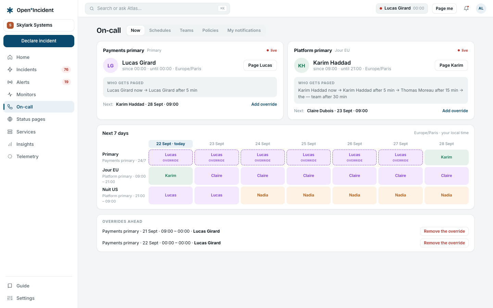
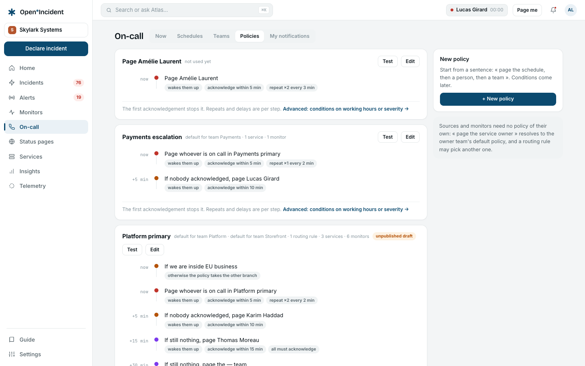
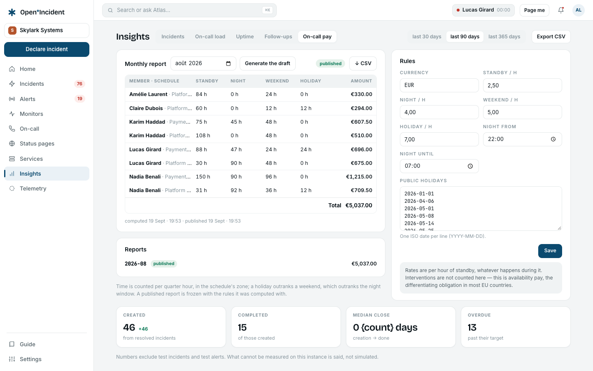

## Am I on call?

**On-call** is one screen with four tabs — **Now**, **Schedules**, **Policies**, **My notifications** — and `?tab=` links straight to each. The rail's card says who carries the pager right now, with **Page me**.

## Now

One card per pager being carried, from every published schedule: the person, since when and until when (in the schedule's zone), **Who gets paged** — the escalation policy read as one line, _Jordan now → Karim after 5 min → Platform team after 15 min_ — and who is **Next**. When no rotation of a schedule is on at this hour (a business-hours rotation at night), the card says _off-hours_ and when it is on again.

- **Page Jordan** pages that person for real, through their own notification rule.
- **Cover me…** (on your own shift) offers it to the other members of the rotation; the first to accept gets an override for it, and you are told.
- **Add override** opens the dialog: a rotation, a member — or _nobody_, which records an assumed gap — and a period.

### The grid

Below the cards, the grid draws one schedule (pick it at the top of the grid when there are several, or with **Open** on the Schedules tab):

- **Week** — the seven days ahead, today first; **Month** — the Saturdays and Sundays of the next two months.
- One row per rotation, one cell per slot: the rotation's own window on that date — its active hours when it has some (09:00 – 21:00), otherwise one handover to the next.
- **Click a cell** and the band asks _who takes this shift?_ with every member as a chip. One click creates an override on that slot only — from now on if the slot is under way — tagged **OVERRIDE** in the cell; the rotation is untouched and everything goes to the audit log. Clicking the cell again offers **Remove the override**.

### People of a rotation

**☰ People · N** under a rotation's name opens its turn order: **1** is the turn under way, then **+1** at the next handover, **+2** after it… with the date each one starts.

- **↑ ↓** change the order, **✕** takes someone out, the **+ name** chips add someone.
- Every change applies **at the next handover**: the person on call finishes their shift, and the shifts already worked keep the person who worked them (past pay and history never move). The panel says from when the new order runs. Taking out the person on call shows them as _leaving at the handover_, with a button to keep them.

## Schedules

A **schedule** is made of **rotations**: ordered members, an interval (daily, weekly, monthly, weekends), a handover time, a timezone, optional active hours (a business-hours rotation is not expected at night). The row sums it up — _2 rotations · follow-the-sun · handover 09:00 / 21:00 · 5 members_ — and warns, in amber, when the next 60 days hold hours with nobody.

- **+ New schedule** creates it as a **draft**: it pages nobody until you **Publish** it. **Follow-the-sun** is one click: a day rotation from the handover time for twelve hours and a night rotation for the other twelve, the same people one turn apart.
- **Members** opens the turn order of each rotation (the same panel as in the grid). **iCal** is the calendar feed — a secret address. **Open** shows the schedule in the grid.

### Coverage

Coverage is measured against the hours the rotations declare: an empty turn, a turn with nobody, an override that removed the only person are gaps. Managers receive one digest a day at most for the gaps of the coming week. **Insights → Pager load** carries the figure across schedules.

## Policies

**Policies** lists the escalation policies, each drawn as a timeline: what happens now, what happens if nobody acknowledged, and how long each step waits. The chips say how a step pages — _wakes them up_ or _silent_, repeats, _5 people_, _all must acknowledge_.

- **Every policy starts with Atlas.** The first step says, per service the policy is the default of, what Atlas does: at level 3 it fixes and the person is paged at the same moment; at level 4 nobody is paged unless Atlas gets stuck, hits a limit or is stopped; below level 3 the policy runs as written.
- Sources and monitors don't need a policy: _page the service owner_ resolves to the owner team's default policy, and **Rules** can pick another one. **Teams and their default policy →** lists the teams: their people, their chat channel, the policy they are paged through.
- **Test** answers _who would be paged right now_; **Edit** opens the editor.

A policy is a graph of nodes:

| Node          | What it does                                                                                                                                                                                                                                                                              |
| ------------- | ----------------------------------------------------------------------------------------------------------------------------------------------------------------------------------------------------------------------------------------------------------------------------------------- |
| **Level**     | Pages targets: a schedule (_on call now_, _next on call_, _everyone on the schedule_), a team, or named members. An urgency (high wakes up, low stays silent), an acknowledgement timeout, retries (every _n_ minutes), and whether everyone must acknowledge or a round-robin picks one. |
| **Condition** | Branches on the working hours (_Working hours "EU business"?_), the severity (_P1 to P2?_) or the urgency. YES continues to one branch, NO to the other, or ends the escalation.                                                                                                          |
| **Delay**     | Waits _n_ minutes, or until a working-hours set opens.                                                                                                                                                                                                                                    |
| **Retry**     | Loops back to a level up to _n_ times, every _n_ minutes.                                                                                                                                                                                                                                 |
| **Reassign**  | Hands the escalation over to another policy.                                                                                                                                                                                                                                              |

### Draft and versions

Editing happens on a **draft**; **Publish v*n*** makes it current. Running escalations finish on the version they started with; new ones take the new one. **Discard the draft** goes back to the published version. Only owners and admins edit policies.

### How a page travels

1. A rule matches an alert (or a responder escalates an incident) and names a policy — one chosen on the rule, or the owner team's default policy for the alert's service.
2. The escalation reaches level 1: each target is resolved to people (who is on call on the schedule now), and each person is notified through the channels of their **own** notification rule for that urgency — Slack direct message, Teams chat, push, voice, SMS, email.
3. The acknowledgement clock starts when the escalation reaches the level; retries within the level never extend it.
4. Nobody acknowledged in time: the next node fires. Someone acknowledged: the timers stop, the timeline and the alert's card say who and how many minutes after the page.
5. Every attempt is written to the outbox with its status before it leaves, so **My notifications** shows what really went out.

The engine is a persisted state machine: ticks are idempotent and replayable, so a worker restart never pages twice and never forgets a level.

## My notifications

See [Sign in and your account](account#your-notifications): how to reach me (Slack direct message and Teams chat with **Acknowledge**, push, voice, SMS, email), the two urgency rules, a real test, what Atlas tells you when it resolves on its own, shift reminders.

## On-call pay

The workspace can price availability: **Insights → Pager load → On-call pay** holds the **Rules** (hourly rates for standby, night, weekend and public holiday; the night window; the holiday dates; the currency) and a **Monthly report** per period.

- **Generate the draft** counts every quarter hour someone is on call for a published schedule, in the schedule's zone, and prices it by category: a holiday outranks a weekend, which outranks the night window.
- **Recompute the draft** at will while the month is open; **Publish** freezes it with the rules it was computed with.
- A member sees their own lines of published months; a manager sees everyone. **Export CSV** exports the month.

> Interventions are not counted here — this is availability pay, the obligation that applies in most EU countries. Rates are per hour of standby, whatever happens during it.
