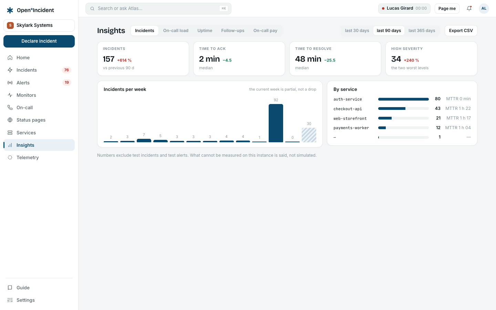
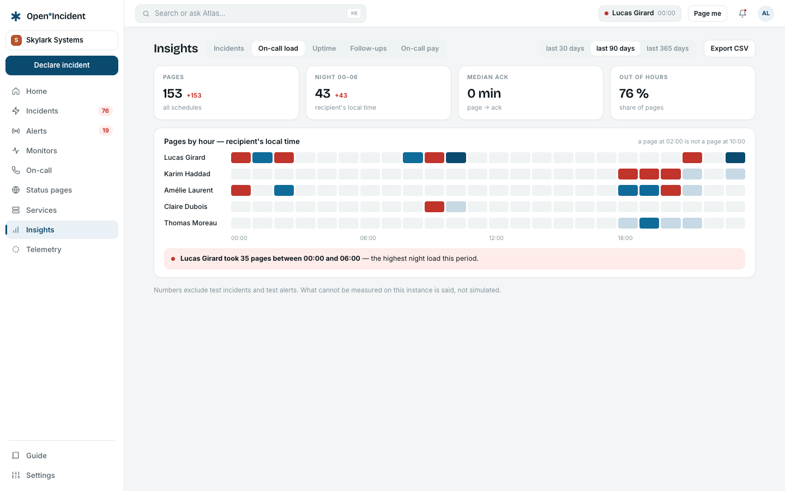
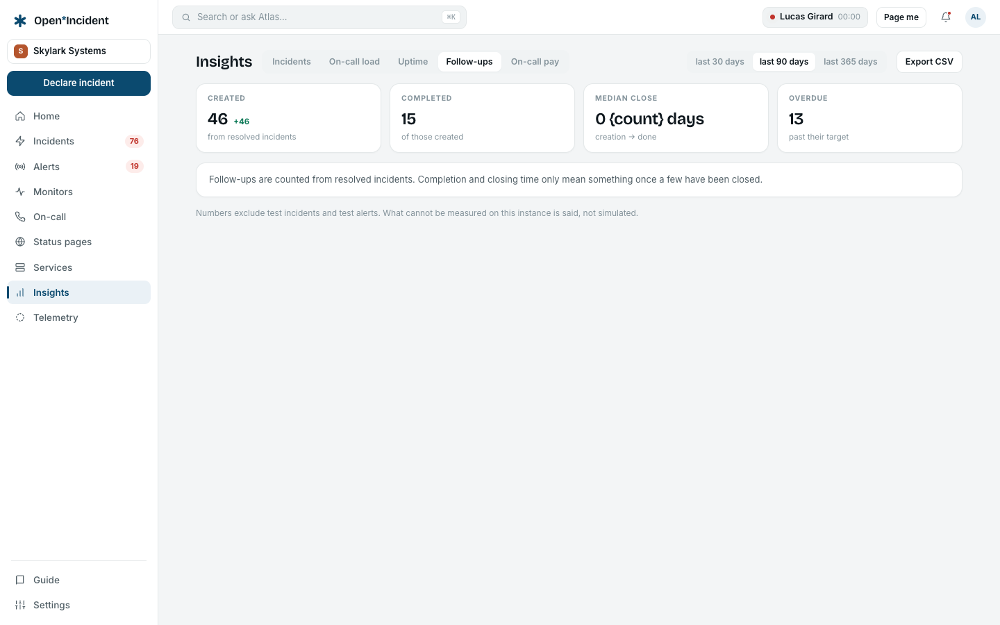

**Insights** answers the questions a team asks about itself, in five tabs: **Incidents**, **✦ Atlas**, **Pager load**, **Uptime** and **Follow-ups** (each one has its own address, `?tab=incidents|atlas|pager|uptime|followups`). The **Last 90 days ▾** menu picks the period — the last 30, 90 or 365 days — and every figure is compared with the previous period of the same length: green when it improved, red when it got worse. The same menu holds **Export this tab as CSV**, the rows behind the tab on screen. Test incidents and test alerts are excluded everywhere; what cannot be measured is a dash, not a zero.

## Incidents

| Figure                             | Meaning                                                                           |
| ---------------------------------- | --------------------------------------------------------------------------------- |
| **Incidents**                      | Declared in the period, versus the previous period.                               |
| **High severity**                  | The two highest severities.                                                       |
| **Median acknowledgement**         | From detection to the first acknowledgement (TTA).                                |
| **Median resolution**              | From detection to resolution (TTR).                                               |
| **Incidents per week / per month** | The current period is partial — the chart says so rather than showing a collapse. |
| **By severity**, **By service**    | The service dimension is the incident's affected service.                         |

## ✦ Atlas

What Atlas did on its own and how well: the share of incidents it resolved alone, its time to resolve against people's, the share of its runs graded right, the share of its actions a person undid (with its cost per incident), who resolved what week by week, a table per service (level, runs, right, time to resolve, undone) and the split of grades over 90 days. The CSV is the per-service ladder.

## Uptime

From the monitors' daily ledger: **Uptime** across all monitors, **Downtime** and **Degraded** time over the period, and the number of active **Monitors** — each against the previous period. A paused monitor counts neither for nor against. The CSV lists every monitor with its own uptime, downtime and degraded minutes.

## Pager load

| Figure                    | Meaning                                                                                                                                                                                                    |
| ------------------------- | ---------------------------------------------------------------------------------------------------------------------------------------------------------------------------------------------------------- |
| **Pages sent**            | Across all schedules.                                                                                                                                                                                      |
| **Median ack**            | From page to acknowledgement.                                                                                                                                                                              |
| **Night pages 00–06**     | In the recipient's local time. When one person carried the heaviest night load, a banner names them and the count — mandatory rest applies in several EU countries; consider moving the handover to 07:00. |
| **Outside working hours** | Share of pages.                                                                                                                                                                                            |
| **Pages by hour**         | A heat strip in the recipient's local time: a page at 02:00 is not a page at 10:00.                                                                                                                        |
| **Coverage**              | Of the next 60 days across published schedules, with the number of gaps and a link to on-call.                                                                                                             |

## Follow-ups

| Figure                   | Meaning                                                                     |
| ------------------------ | --------------------------------------------------------------------------- |
| **Created**, **Closed**  | In the period.                                                              |
| **Median closure**       | From creation to done, against the P1 policy.                               |
| **Closure rate by team** | Teams are the owner teams of the services involved.                         |
| **Overdue now**          | With the priority and the days late, and a link to the **Follow-ups** view. |

## On-call pay

Reached from the bottom of **Pager load** (`?tab=pay`), it holds the pay rules and the monthly reports — described in [On-call](on-call#on-call-pay). The tab's CSV export takes a `period=YYYY-MM` parameter.
