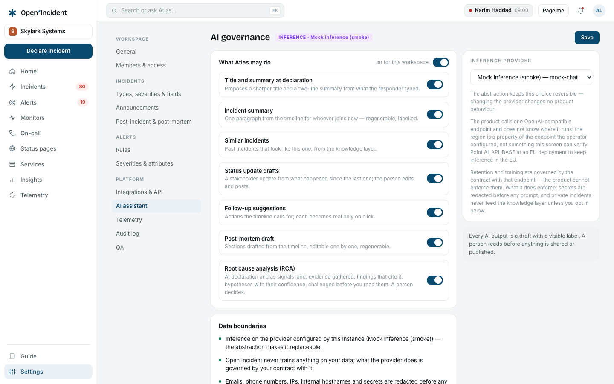

## The principle

The assistant's drafts — updates, summaries, post-mortems — carry a visible **draft · Atlas** label and wait for a person. What Atlas may _do_ on its own is earned per service: from investigating only, to proposing a fix a person approves, to running a reversible fix and resolving the incident, told afterwards with 24 hours to undo (see [Atlas's autonomy](#atlass-autonomy) below). It reads the incident's own timeline first, then the sources the workspace allows; what alerts, logs and tickets contain is data it reads, never instructions it follows.

It exists only when the operator configured an inference provider on the instance (`AI_API_BASE`, `AI_MODEL` — any OpenAI-compatible endpoint: Mistral La Plateforme, an EU-region deployment, a self-hosted Ollama or vLLM). Without it, every assistant function is shown as unavailable; nothing is simulated.

## What it does

| Capability                           | Where                     | What you get                                                                                                                                    |
| ------------------------------------ | ------------------------- | ----------------------------------------------------------------------------------------------------------------------------------------------- |
| **Title and summary at declaration** | The declaration form      | **Propose a title and summary** drafts both from what you typed.                                                                                |
| **Incident summary**                 | The incident's side panel | One paragraph from the timeline for whoever joins now; **Regenerate** at will; the generation time is shown.                                    |
| **Similar incidents**                | The side panel            | Past incidents that look like this one — _by meaning_ when an embedding model is configured, _by title_ otherwise, and the panel says which.    |
| **Status update drafts**             | The update dialog         | **Draft with AI** writes the stakeholder update from what happened since the last one.                                                          |
| **Follow-up suggestions**            | The follow-ups tab        | **Suggest follow-ups** proposes actions the timeline calls for; each becomes real only when you click **Create**.                               |
| **Post-mortem draft**                | The post-incident tab     | The template's sections drafted from the timeline; per section, regenerate, tighten, enrich or rewrite; a check of the whole against the facts. |
| **Root cause analysis (RCA)**        | The incident's RCA tab    | Evidence gathered, findings that cite it, hypotheses with their confidence, challenged before you read them — see below. Enterprise edition.    |

The side panel also shows the affected service's **Runbooks** and the **Recent changes** (deploys, flags, config changes posted through `POST /api/v1/change-events` in the day before the incident and until its resolution) — both are read by the assistant when allowed.

## Root cause analysis (RCA)

The **Root cause analysis (RCA)** tab of an incident is where the assistant does the hardest part of the response: saying what broke and why, from evidence, before anyone starts digging. It is part of the enterprise edition (`aiInvestigations` entitlement) and has its own switch in **Settings → AI assistant**.

### What an assessment does

1. **Gathers the evidence**, check by check: the incident's timeline, the alerts linked to it, the changes recorded in the day before and since (deploys, flags, configuration — service-scoped), the past incidents that look like it with the cause their post-mortem documented, the service's runbooks, who owns the service, and what responders told the analysis. Every item gets an id — `E3`, `A1`, `C2`, `S1`, `R1`, `O1`, `N1`. A source the workspace switched off is shown as _skipped_, never silently absent.
2. **States findings** — one fact each, citing at least one evidence id. A finding that cites nothing the material contains is dropped, not shown.
3. **Proposes root cause hypotheses** — _what broke_ and _why_, each resting on listed findings, with an explicit **confidence**: _speculation_ (no direct evidence), _plausible_ (one supporting finding), _likely_ (several converge), _strong_ (they converge and nothing contradicts them), _validated_ (the material confirms it). A hypothesis resting on no finding is kept but flagged as speculation; one finding cannot carry more than _plausible_.
4. **Challenges them**: a second, adversarial pass looks for evidence that contradicts each hypothesis, alternatives the same findings fit, timing that does not match. A contradicted hypothesis stays visible, at the bottom, with the reviewer's note and citations; a weakened one loses a notch of confidence and is flagged.
5. **Writes one synthesis** — _What's going on_, _What caused it_ (with the confidence), _What you can do next_ — and posts it in the incident's Slack channel (Teams gets it as a note). The Slack message is **updated in place** at every assessment, with a **Re-assess** button.

The assessment runs **at declaration** of a live incident, again when a **new signal** lands (a change event recorded on the service, through the API), when a responder **adds a note**, when someone asks (**Re-assess**, in the tab or in Slack), and through the API. A running assessment is never interrupted: a trigger that arrives meanwhile is served right after it.

### What a person does

- **Steer** — tell the analysis what you know (_the rollback at 14:41 did not restore service_): the note is attributed to you, cited like any evidence (`N1`), and a new assessment runs with it.
- **Pause** — signals stop re-assessing; a person can still ask for one. **Resume** when you want the automatic passes back.
- **Send to the post-mortem's RCA section** — after resolution, the surest surviving hypothesis, its findings and their citations become the post-mortem's **Root cause analysis (RCA)** section, as an **AI DRAFT**, only while that section is empty. You edit from there.
- **Grade** — once the post-mortem names the cause, say how close the analysis came: _Bullseye_, _On target_, _Miss_, _Nowhere near_, with an optional note. Grades are how the workspace measures the accuracy it can trust.

Every model call is in the call log; the material is redacted before it leaves the instance; nothing the analysis says is executed. The timeline records each assessment and its outcome.

### Through the API

`GET /api/v1/incidents/{ref}/investigation` returns the analysis — status, triage, synthesis, hypotheses with their confidence and the reviewer's notes, findings and the evidence they cite, checks, grade. `POST` on the same path asks for a new assessment (scope `write`, `202`), or answers `409 unavailable` when the workspace may not have one. See [API and automation](api).

## Governance

**Settings › Atlas**, below the autonomy blocks, decides per workspace:

- The **master switch** — on or off for this workspace.
- Each **AI function** — a switch per capability above.
- The **sources the assistant reads**: incidents and post-mortems (always), services and teams, change events, and **Runbooks and documents** (off by default).
- Whether **private incidents feed the knowledge layer** outside their own incident (off by default).

### Data boundaries, stated on screen

- Inference runs on the provider configured by this instance, named on the screen; the abstraction makes it replaceable without changing the product's behaviour.
- **Emails, phone numbers, IPs, internal hostnames and secrets are redacted** before any prompt leaves the instance.
- Open Incident never trains anything on your data; what the provider does is governed by your contract with it.

### The call log

Every call is logged: who made it, on which incident, which capability, which model, how many tokens, how long. The log is on the same screen.

## Refusals you may see

| Message                                                              | Cause                                                 |
| -------------------------------------------------------------------- | ----------------------------------------------------- |
| _No inference provider is configured on this instance._              | The operator has not set `AI_API_BASE` / `AI_MODEL`.  |
| _AI functions are switched off for this workspace._                  | The master switch.                                    |
| _This AI function is switched off in the workspace's AI governance._ | The capability's own switch.                          |
| _The assistant did not answer. Nothing was written; try again._      | The provider failed or timed out; no draft was saved. |
| _Root cause analysis is part of the enterprise edition._             | The `aiInvestigations` entitlement is not on.         |

## Atlas's autonomy

**Settings › Atlas** (`/app/settings/ai`) is where what Atlas may do is earned, bounded and paid for.

### Levels, earned per service

| Level          | What Atlas does                                                                              | To reach it (from the level below)                                          |
| -------------- | -------------------------------------------------------------------------------------------- | --------------------------------------------------------------------------- |
| L0 Observe     | reads, says nothing unless asked                                                             | a new service                                                               |
| L1 Investigate | runs the analysis, findings and drafts                                                       | 5 incidents seen                                                            |
| L2 Propose     | prepares a fix from the allowed actions; a person approves in one tap (web, chat, phone)     | 10 graded runs · 80 % right                                                 |
| L3 Act & tell  | runs the reversible fix at once **and** pages a person at the same moment                    | 20 graded · 90 % right · backtest ≥ 85 % · 5 proposals approved unchanged   |
| L4 Resolve     | runs the fix, verifies, resolves; nobody is paged, people are told afterwards; undo for 24 h | 40 graded · 95 % right · 10 level-3 fixes never undone · no Miss in 30 days |

A run is graded after closure (Bullseye, On target, Miss, Nowhere near). A Miss, or a person undoing an action Atlas took alone, costs one level; Nowhere near, or an incident reopened after Atlas resolved it, sends the service back to L1; _Reopen_ in the review queue costs one level. After a fall, a service climbs back only with five new right runs. Promotion is checked after every grade and every quarter of an hour, one level at a time. An admin can only **cap** a service (the _Cap_ column); the level that applies is the lower of the two. Every change of level is in the audit log, under Atlas.

### Allowed actions — connecting your automation

Atlas acts on your systems only through the **allowed actions**, and nothing else. Each one is connected to your own automation by clicking its name: a **Do URL**, an **Undo URL** (without it the action is not reversible and can never be switched on) and an optional **Verify URL**. Atlas sends a `POST` with `{action, phase, id, incident, target, sentAt}`, an `idempotency-key` header, and `x-openincident-signature: t=<epoch>,v1=<hex HMAC-SHA256(secret, "<t>.<body>")>`. Answer `2xx` with `{ "ok": true, "ref": "…" }`; the verify URL answers `{ "healthy": true }` once the system is back. The signing secret is shown once, when you rotate it (_Rotate the secret_). Without a verify URL, Atlas waits for the incident's alerts to clear. A fix not verified within 15 minutes pages a person.

Kubernetes restarts, feature flags, deploy rollbacks and runbook endpoints all go through this signed HTTP call: the instance holds no cluster credentials.

### Always ask a person first

Whatever the level: SEV1 incidents (until someone acknowledges), Security and private incidents, the first time an action is used on a service, a change freeze, customer-facing status page updates — each a switch — and, locked, anything outside the allowed actions. A **change freeze** is a change event posted through the API with `payload.freeze_until` (ISO date), for one service or all of them.

A rule can also say **✦ Never let Atlas act** (it then only investigates) or **✦ Let Atlas handle it**.

### Stop, backtest, budget

- **Stop Atlas everywhere** withdraws every waiting proposal; Atlas keeps reading and answering, and acts nowhere until someone lets it act again. _Stop_ on one incident, and `/incident atlas stop` / `atlas stop all` in Slack and Teams, do the same in their scope.
- **Backtesting** replays the closed incidents of the last 90 days that have a documented cause (a post-mortem's root cause, or a run graded right), with only what was known 15 minutes in, through the configured provider, and grades each against the cause. Its per-service score is the backtest criterion of L3.
- **Budget**: this month's spend, from every run and backtest (tokens at the instance's prices, `AI_PRICE_IN_EUR_PER_MTOK` / `AI_PRICE_OUT_EUR_PER_MTOK`, defaults 2 and 6). At the monthly budget, runs in progress finish and no new one starts; at the cap per run, that incident stops being re-assessed.

### Hearing about it

At L4 nobody is paged: the first page of the policy is held for 10 minutes while Atlas tries, released the moment it needs a person. Each member chooses in _On-call › My notifications_ how they hear about an autonomous resolution: a silent push right away (with **Undo** and **Review**), a summary at 09:00 (default), or nothing. A proposal pushes **Approve** / **Open** to the service's owners. These one-tap links work without signing in, expire after 24 hours, and change nothing until the button on the page is pressed.
