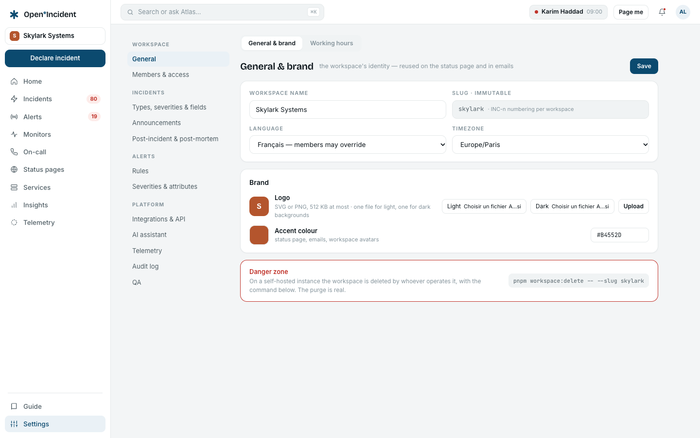
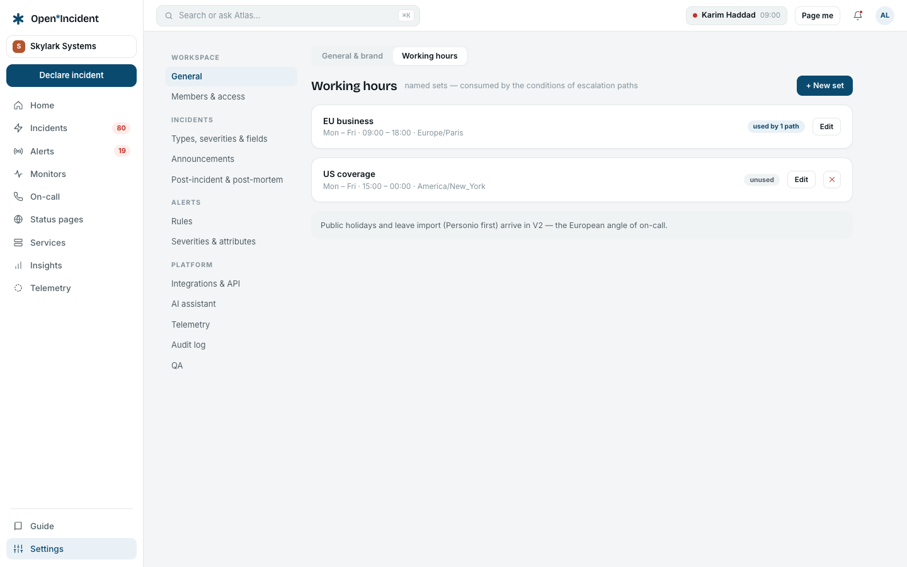
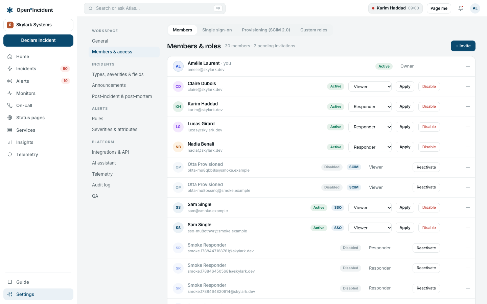

The **Settings** section is reserved to members who hold at least one settings permission — owners and admins with the built-in roles. The navigation shows the entries the member holds; a viewer or responder who lands on a screen by URL reads why, and no form is rendered.

## The overview

**Settings** opens on an overview: the workspace, the edition (self-hosted or cloud) and your role, then **Needs your attention** — only what is true right now, each line a link to the screen that fixes it:

- an **Opsgenie migration** under way, with the days left before Opsgenie shuts down (5 April 2027) and which teams are still paged by it;
- a **diagnostics suite** whose last run failed (owners only), with how many checks failed;
- an **API key** that expires within 30 days, and when it was last used;
- a **webhook endpoint** in a failure streak, and what it answers;
- an **invitation** pending for three days or more, and when its link expires.

Under it, one card per group lists every screen with a line read from the workspace's rows — _8 active · 2 invited_, _4 rules · first match wins_, _Traces 7 d · logs 14 d_. A line in orange or red wants a look.

## The navigation

Five groups, one entry per screen — no tabs hidden inside an entry:

| Group               | Entries                                                                                             |
| ------------------- | --------------------------------------------------------------------------------------------------- |
| **Workspace**       | General · Brand · Working hours · Subscription (cloud deployments only)                             |
| **People & access** | Members · Roles · Single sign-on · Provisioning (the last three: enterprise edition)                |
| **Incidents**       | Slack & Teams · Types & lifecycle · Severities · Custom fields · Announcements                      |
| **Alerts**          | Rules · Alert severities · Labels                                                                   |
| **Platform**        | Migrate from Opsgenie · Integrations · API & webhooks · Atlas · Telemetry · Audit log · Diagnostics |

**Find a setting**, above the groups, filters the entries on their name, the line that says where they stand and their group — _okta_, _expire_, _slack_ all land. An enterprise screen the instance is not entitled to wears **EE**; an entry whose state wants a look carries a dot in that colour.

The screens renamed with this layout keep their old addresses as redirects: `/app/settings/alert-routes` → **Rules** (`/app/settings/rules`), `/app/settings/alert-priorities` → **Alert severities** (`/app/settings/alert-severities`), `/app/settings/alert-attributes` → **Labels** (`/app/settings/labels`). Two things an administrator reads often are not settings and live where they are used: **alert sources** under [Alerts → Sources](alerts#from-a-webhook-to-an-alert), and **heartbeats** under [Monitors → Heartbeats](monitors#dead-mans-switches-use-heartbeats).

## One template

Every screen reads the same way: a breadcrumb, the title, one sentence, the actions on the right; then cards of rows — the label and its help on the left, the control on the right — and lists of objects on the same row template. A change to a form brings **one save bar** at the bottom of the screen, _Unsaved changes on this page_, with **Discard** and **Save changes**; nothing changed, no bar. Creating something opens a dialog on the same template, and a secret — an API key, a provisioning token — is **shown once**, in that dialog, never again. What the instance does not have is said, with its reason: _Unavailable on this instance_ and the variable, edition or module that switches it on.

## General

| Setting              | Notes                                                                                                                                                              |
| -------------------- | ------------------------------------------------------------------------------------------------------------------------------------------------------------------ |
| **Workspace name**   | Reused on the status page, in emails and in incident numbers.                                                                                                      |
| **Slug**             | Fixed at creation — it is the subdomain. Incidents are numbered `INC-n` per workspace.                                                                             |
| **Language**         | English, French or German; members may override it in their profile.                                                                                               |
| **Default timezone** | Working hours, reports and emails use it; a member's own timezone wins for them.                                                                                   |
| **Danger zone**      | On a self-hosted instance the workspace is deleted by whoever operates it, with the command shown (copy it). In the cloud, deletion is done from the subscription. |

## Brand

- **Logo** — one file for light backgrounds, one for dark ones; SVG or PNG, 512 KB at most. **Upload** sends the file the moment it is picked. Stored in the instance's object storage under the workspace's own prefix and served with a sandboxing policy, so an uploaded SVG can never run script. Without object storage (`S3_*`) the upload is not offered and every screen shows the initial on the accent. **Remove the logos** goes back to the initial.
- **Accent colour** — six swatches, or any hex. The preview beside it follows the pick before you save: the status page's header and an incident email, written from the workspace's latest public incident.

## Working hours

Named sets — _EU business: Mon–Fri 09:00–18:00_, _Weekend support_ — read by the **conditions** and **delays** of escalation policies (_in working hours "EU business"?_, _wait until "EU business" opens_) to page differently in and out of hours. The selected set is drawn as a week — a bar per day on a 24-hour axis — with the policies that read it. **+ New set** and **Edit** take a name, the days (Mon – Fri, Mon – Sat, every day, Sat – Sun; a set saved with other days keeps them), the hours and the timezone. An end before the start wraps past midnight. A set a policy reads cannot be deleted — change the policy first; one nobody reads has a **Delete**.

## Subscription

Cloud deployments only — on a self-hosted instance the entry and the screen do not exist. The plan, the seats in use against those paid for, the next invoice and its amount; this month's usage against the plan's ceilings; the offers while there is no subscription; the invoices with their PDF. **Open the cloud console** (owners) manages payment, seats and cancellation.

## People & access

Four entries: **Members**, then three enterprise screens — **Roles**, **Single sign-on** and **Provisioning** — each described in its own chapter ([Custom roles](custom-roles), [Single sign-on](sso), [Provisioning (SCIM)](scim)). Without the entitlement, each of the three says _Unavailable on this instance_ and names the line that switches it on, `OI_ENTITLEMENTS=sso,customRoles`. Nothing is simulated.

### Members

One card holds everyone who can sign in to the workspace:

- **Filter chips** — _All_, _Active_, _Invited_, _Disabled_ — each with its count, and a **Search name or email** field. The link of the settings overview's "invitation pending" item opens the list on _Invited_ (`/app/settings/members?f=invited`).
- A row per person: the avatar and name (yours marked **you**) with the email; the **role**; the **teams** they belong to; how they **sign in**; when they were **last active**; and the one action that applies.
- The **role select** saves on change, and the change is written to the audit log: **Owner** (only an owner appoints one), **Admin**, **Responder**, **Viewer** — and the workspace's custom roles when the enterprise edition is entitled. You cannot change your own role, and an admin cannot change an owner's.
- **Sign-in** reads the identity's accounts: **SSO** when the member signs in through one of the workspace's single sign-on connections (or was created by one), **Password** otherwise; **Invited** and **Disabled** say where the others stand. A member who has never set a password nor used SSO shows a dash.
- **Last active** is the last time the member opened the product (updated at most every five minutes). For an invitation it is the link's validity instead — _link valid 5 days_, _link expires tomorrow_, _link expired_ — counted seven days from the last invitation email sent; the line under the address says who invited them and when.
- **Disable** refuses the member at the door from then on; their name stays on incidents, timelines and audit lines — nothing is deleted. **Reactivate** reverses it.
- An invitation can be **resent** (a new link valid seven days) or **revoked** (the row goes; nothing was ever accepted).
- A member deactivated by your identity provider through [provisioning](scim) shows _Managed by Okta_ (the provider's name is the first SSO connection's) and when it was removed: reactivate them in the provider, which owns them.

**+ Invite** takes a list of addresses, separated by commas or new lines, and one role for the batch — a built-in role or a custom one. Each address receives a link valid for seven days; an address that is already a member is skipped.

What each role may do is in [Concepts](concepts#roles-and-permissions) and, for custom roles, [Custom roles](custom-roles).
