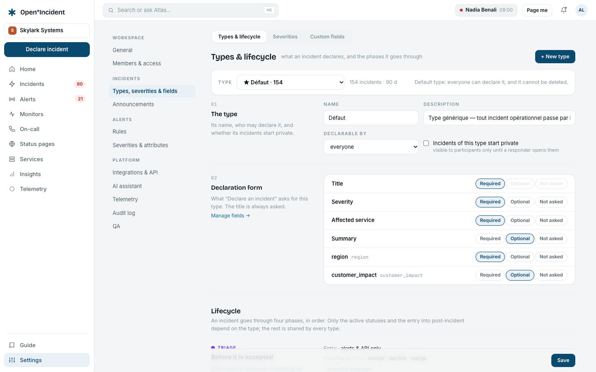
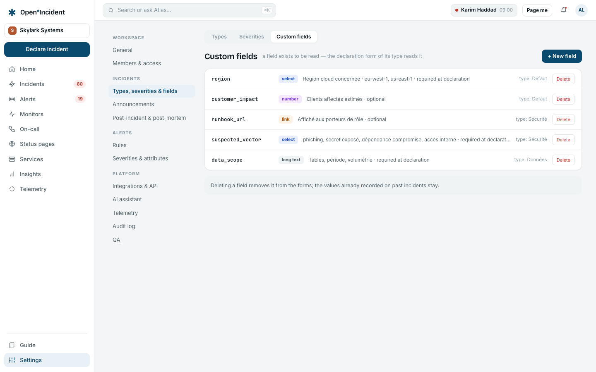
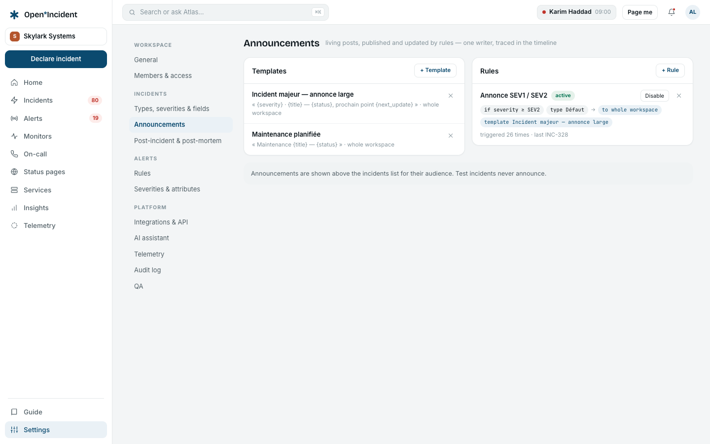

## Types, severities & fields

One entry, three tabs: **Types & lifecycle**, **Severities**, **Custom fields**.

### Types & lifecycle

Pick the type in the selector at the top — ★ marks the default type, and each type shows how many incidents it carried over ninety days. Below it, the type's sheet reads top to bottom, and one **Save**, which stays in view at the bottom, saves everything on it that is a value. What is a list — statuses, post-incident tasks — is changed on the spot, nothing to save.

| Part                          | What you decide                                                                                                                                                                                                                                                                                                                     |
| ----------------------------- | ----------------------------------------------------------------------------------------------------------------------------------------------------------------------------------------------------------------------------------------------------------------------------------------------------------------------------------- |
| **01 The type**               | Name, description, **who may declare it** (everyone, or one team), and whether its incidents **start private**. The default type is everyone's and cannot be deleted; another type can be deleted, from the selector bar, while no incident carries it.                                                                             |
| **02 Declaration form**       | One choice per field — **Required**, **Optional**, **Not asked** — for severity, affected service, summary and the custom fields of this type or of every type. The title is always asked. **Manage fields →** adds or removes custom fields.                                                                                       |
| **Lifecycle · Triage**        | Shared by every type: incidents created by an alert or the API wait here until a responder accepts, declines or merges them.                                                                                                                                                                                                        |
| **Lifecycle · Active**        | The type's own statuses, **in order**: an accepted incident starts at the first and only advances by an explicit update. Each has a name, a description, an **update reminder**, the **public status** it maps to, and whether it **counts in the MTTR**. Reorder with the arrows; a status with incidents in it cannot be deleted. |
| **Lifecycle · Post-incident** | When a resolved incident **of this type** enters the flow — _never_, _always_, or _from_ a severity. Then, shared by every type: the tasks of the two phases (**Document**, **Review**), the **post-mortem term** the workspace uses, and the **post-mortem template**.                                                             |
| **Lifecycle · Closed**        | Shared by every type: skipping a step needs a reason, traced in the timeline; reopening is possible for 30 days.                                                                                                                                                                                                                    |

Each post-incident task has a title, a phase, a default assignee (the incident lead, the communication lead, nobody) and a deadline in days after entering the phase; a new task applies to incidents entering the flow from now on. The **post-mortem term** is the word the workspace uses — _post-mortem_, _retro_, _RCA_ — everywhere the product names it. The **template** is the list of sections a new post-mortem starts with, and what each should hold; documents already written keep theirs.

### New types

**+ New type** inherits the statuses and form of the type it is based on — adjust afterwards on its sheet.

### Severities

Ordered and shared. Each carries a description, a colour, and the **post-incident entry** rule: _always_, _yes_, _opt-in at closure_, _no_. Changing a severity on an incident is a timeline event.

> Severity ≠ priority ≠ urgency. Severity qualifies the incident; priority qualifies the alert; urgency picks the notification channel.

### Custom fields

A field exists to be read: the declaration form of its type reads it, the incident shows it, the API and the webhook payloads carry it under `custom_fields`.

- **API name**: lowercase letters, digits and underscores (`region`, `customer_impact`).
- **Type**: text, long text, select (options one per line), number, link.
- **Incident type**: one type, or all types.
- **Required at declaration** or optional.

Deleting a field removes it from the forms; the values already recorded on past incidents stay.

## Announcements

Announcements are **living posts**: a rule publishes one when an active incident matches, keeps it updated at every status update and closes it at resolution. They are shown above the incidents list for their audience; with Slack or Teams connected, in the announcement channel as well. Test incidents never announce.

- **Templates**: a name, an **audience** (whole workspace, owning team, role holders), a body with variables `{severity}`, `{title}`, `{status}`, `{next_update}`, `{reference}`, `{service}`, `{lead}`, `{summary}` — re-rendered at every update.
- **Rules**: _if severity ≥ SEV2_ and optionally _type = …_, _then publish template …_. Each rule shows how many times it triggered and the last incident.
