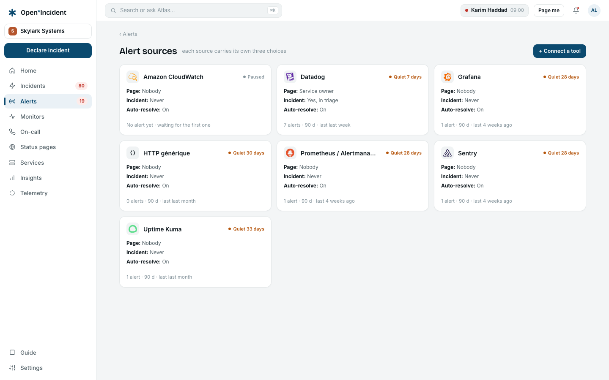
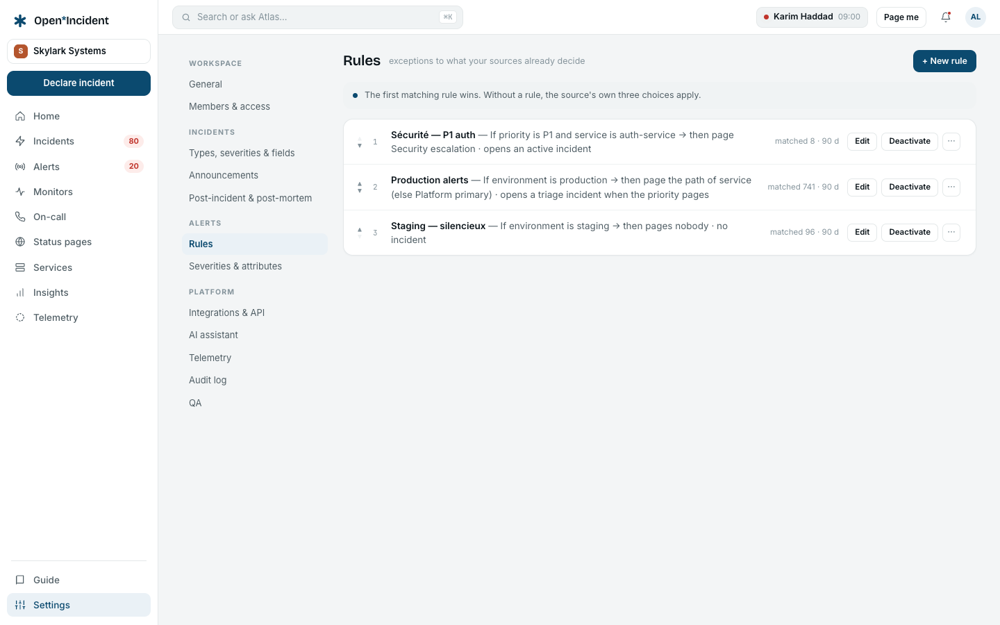
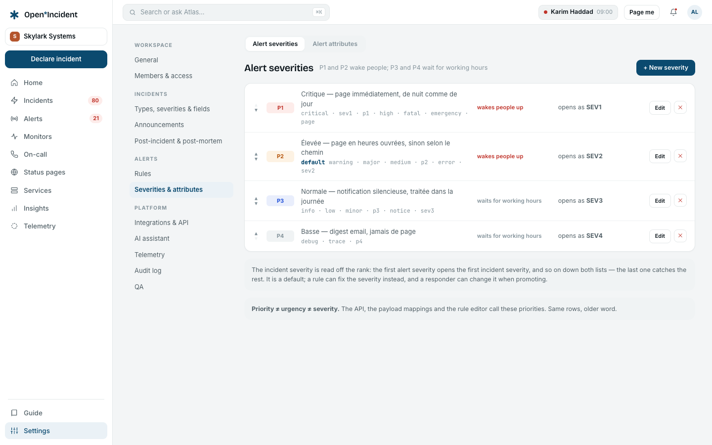

## Two entries

The Alerts group holds what an administrator decides about alerts and nothing else: **Rules**, **Alert severities** and **Labels** — the vocabulary the rules read. Sources are not a setting; they are read, created and configured under **Alerts → Sources**, where the alerts they produce are. Heartbeats are not a setting either; they live under **Monitors → Heartbeats**, beside the other thing that watches by waiting.

Nothing has to be declared beforehand. Every new workspace starts with its alert severities (P1 and down, with the names the tools usually give them), a reading of the usual labels (service, team, environment, region) and the defaults every source starts from — open a triage incident when an alert wakes people. The welcome screen's **Who should we page?** step names who to page, and it is live.

## Alert sources

Under **Alerts → Sources**, not in the settings — described here because the rules below read what the sources produce.

One source = one dedicated endpoint + one secret compared in constant time. **+ New source** picks the **tool** in a grid (Datadog, Prometheus/Alertmanager, Grafana, Sentry, CloudWatch, Uptime Kuma; **HTTP** for anything that can post JSON), a name, and shows the endpoint and the secret once. Only the secret's SHA-256 is stored. On the source page, **Rotate the secret** gives a new one, shown once, and the old one stops working at once. The secret travels as the `x-oi-secret` header or the `?secret=` query parameter. **Delete this source**, beside it, asks first and says how many alerts leave with it — the tool posting to the endpoint then gets a 404. The two sources the product manages itself, _Monitors_ and _Heartbeats_, cannot be deleted.

### The source page

Each source has a page — **Configure** — with everything about it:

- **Connect the tool**: the endpoint, the secret, the steps for this kind of tool, a `curl` command that sends a first alert, and a line that waits for it and turns green when alerts arrive.
- **Attributes**: how this source's payload becomes the workspace's attributes. One row per attribute: the payload field (picked from the fields of a real alert the source sent, or a fixed value), a light transform (lower case, after the colon, first word…), an optional guard (keep the value only if it matches a regular expression), and the value that comes out of the chosen sample. **Suggest from the payload** proposes fields for the attributes not yet mapped, from the names tools usually use. Required attributes the source does not map are flagged.
- **Priority**: none (the payload's own label, else the default), always the same, or from a field with a value map — `critical → P1` — and a fallback. Labels not listed still match a priority by its name or aliases.
- **Filter incoming alerts**: only alerts matching the conditions are ingested; resolutions always pass, so nothing stays firing forever.
- **Preview and test**: paste a payload and read what the pipeline would do — attributes, priority, the rule that catches it, who it pages, the incident it opens, the group it would join — then **Send as a test alert** (routed, nobody paged) or **Send for real**.
- The **rules** that apply to this source, in order.

### Per tool

| Tool                          | In the tool                                                                                                                                                      | How the payload is read                                                                                                                                                                                                                                            |
| ----------------------------- | ---------------------------------------------------------------------------------------------------------------------------------------------------------------- | ------------------------------------------------------------------------------------------------------------------------------------------------------------------------------------------------------------------------------------------------------------------ |
| **Datadog**                   | Integrations → Webhooks: a webhook with the endpoint URL and a custom header `x-oi-secret`; attach it to the monitors' notifications (`@webhook-open-incident`). | Title from `title` / `event_title`, body from `body`; the monitor's `scope` (`env:prod,service:checkout-api`) becomes attributes (`env` → `environment`); `priority` kept; deduplicated by `monitor_id` (or `alert_id`); a _Recovered_ / _OK_ transition resolves. |
| **Prometheus / Alertmanager** | A `webhook_configs` receiver with the endpoint URL and the secret in a header.                                                                                   | One alert per entry of the batch; labels become attributes; deduplicated by the fingerprint; `status: resolved` resolves.                                                                                                                                          |
| **Grafana**                   | A contact point of type Webhook with the URL and the secret in a header.                                                                                         | Same as Alertmanager (Grafana sends the same shape), deduplicated by the rule id; annotations land in the description.                                                                                                                                             |
| **Sentry**                    | Project → Alerts → an alert rule with a webhook action (or the Webhooks integration) to the URL with the secret.                                                 | Issue title and culprit; the issue's tags become attributes (`env` → `environment`); deduplicated by the issue id; the _resolved_ action resolves; link back to the issue.                                                                                         |
| **CloudWatch**                | An SNS topic subscribed by HTTPS to the endpoint (the secret in the URL); alarms notify the topic.                                                               | The alarm inside the SNS envelope: `AlarmName` as title, `NewStateReason` as description, `Region` as attribute; deduplicated by the alarm ARN; `OK` resolves.                                                                                                     |
| **Uptime Kuma**               | A Webhook notification with the URL; the secret in a custom header.                                                                                              | Monitor name and URL; the monitor name is the `service` attribute; up resolves, down fires; deduplicated by the monitor id.                                                                                                                                        |
| **HTTP**                      | Any tool that can post JSON.                                                                                                                                     | Free schema: `title`, `description`, a `dedup_key` / `fingerprint` / `id` as deduplication key (the title otherwise), a status field matching _resolved / ok / recovered / closed / up_ resolves; every string field becomes an attribute the mappings can rename. |

Adding a dedicated tool is a parser plus default mappings, not a connector — that is how the long tail is covered; and any tool is one HTTP source away.

## Rules

**Settings → Rules** holds the exceptions to what your sources already decide. Every source carries three choices of its own — who to page, whether an incident opens, whether recovery closes it — and an alert that matches no rule follows them. That is why a workspace with no rule at all still pages somebody.

Rules are tried **in order** and the **first matching rule wins**. Each one reads as a sentence — _If source is Datadog and severity is P1 or P2 and label environment = production_ — and, under it, what it does: _→ page Platform · open an incident at SEV2_. A rule is something written to apply to some alerts: a condition, or a chosen source. On the right, how many alerts the rule decided over the last seven days; a rule that has decided none yet says who added it and when, read from the audit log.

- **+ New rule** opens the rule as the four lines of a sentence: **If source is** (any source, or one), **and severity is** (any, one level, _P1 or P2_, _P3 or lower_…), **and label** (`key = value`, or `key != value`, optional), **then** — page a team (its escalation policy), page the service's owner, open an incident at a severity, **✦ let Atlas handle it**, **✦ never let Atlas act**, or **mute** (nobody paged, no incident). **Add at the end** puts it after the last rule. A rule needs at least a source, a severity or a label: without one it would catch every alert.
- **Edit** opens the same dialog for a rule it can hold. Changing **then** changes only that part — a rule that pages Platform and opens an incident at SEV2 keeps paging Platform when you set it to open the incident at SEV1 — and the dialog says what stays. **More options…** opens the rule on its own page with the full editor.
- **Move a rule** by dragging its row, or from the keyboard: focus its number and press ↑ or ↓. The new order is saved at once, and the audit log records it — _moved rule 2 above rule 3_.
- **Preview on the last 50 alerts** replays the rules as they stand on the alerts that arrived: how many a rule catches, and how many would now be handled differently from the way they were when they arrived. Nothing is sent.

The two **✦ Atlas** choices are read by Atlas on every incident the rule's alerts open: **never let Atlas act** stops it from doing anything but reading, whatever the service's level; **let Atlas handle it** lets it try first, within the level the service already allows — it never raises one.

The rule's own page — **More options…** — is the full editor:

- **Sources**: every source, or only some.
- **Which alerts**: conditions on any label, or on the source, its name, the severity, the title — _is, is not, is one of, is none of, contains, matches (regex), is set, is missing_. Lines in a group are ANDed; groups are ORed.
- **Who to page**: steps that stack. **Page a policy** names one; **page from a label** follows a `service` or `team` label to the escalation policy it leads to — the service's owner team, or the team itself — with a fallback when the chain does not resolve. **Page me**, a schedule or a colleague make a published one-level policy in one click.
- **Incident**: never, always, or when the alert wakes people; the type, whether it starts in triage or active, the severity (from the alert's, fixed, or none), private or not, custom fields filled from labels, and whether a triage incident is declined when the alert resolves.
- **Grouping**: the labels the key is built from, the window in minutes — fixed, or restarting at each alert that joins — what a joining alert does to paging (nothing, page again, page again if the severity rises), and a grace before the first page.
- **Slack channel**: where every alert this rule catches is posted.
- **Options**: a severity when the source names none, an urgency override, a wait before the first page, whether the escalation is cancelled when the alert resolves, **test mode** (logs everything, pages nobody, opens no incident), active.
- **Against the last alerts** previews the draft before it is saved; **Delete this rule**, in the page's header, asks first.

The foot of the list leads to **what every source starts from**: not a rule, but the grouping, urgency and options every alert begins with when no rule matches.

## Alert severities

**Settings → Alert severities** — P1 to P4 — is what an alert is worth, and what each level does on its own. A level that **wakes people** calls the person on call (chat and push at once, a call after a minute without acknowledgement) and, unless a rule says otherwise, opens an incident at the incident severity of the same rank — P1 opens a SEV1. A **silent** level sends a silent push and the 09:00 email **digest**, and opens no incident by itself.

**Edit** changes a level's name, its label (_P1 — Critical_), whether it wakes people, the names the tools give it — `critical`, `sev1`, `warning`…, matched case-insensitively — its colour, and whether it is the level of an alert that names none. The change applies to new alerts only. A source maps its own levels to these; rules can raise or lower them.

## Labels

**Settings → Labels** lists the keys seen in your alerts over the last ninety days — observed, never declared: whatever a source sends is a label as soon as it arrives. Each row says the key, its values (or how many there are), and how many alerts carried it. The keys the product writes itself on every alert — the source, the severity — are not listed. A label that stops appearing for 90 days leaves the list; rules that read it keep working.

Two marks say what the product does with a key: **ties alerts to Services and their owners** on the key that names a service — its value is matched against the workspace's services, and the owner team is filled in, which is what lets a rule page the owner — and **redacted before Atlas** on a key whose values the redaction applied before any model call rewrites (email addresses, phone numbers, IP addresses, internal hosts, secrets).

A manager clicks a label to say how the pipeline reads it: the name screens show it under, whether it names a **service**, a **team**, an alert severity, a list or plain text, whether every alert is **expected** to carry it (sources that do not send it are flagged on their page), and what a repeat of the same alert does to its value — keep the first, keep the last, collect every value, keep the highest severity. A key read as more than plain text, or expected on every alert, stays on the list even while no alert carries it.

## Heartbeats

Moved: **Monitors → Heartbeats**. A dead man's switch per job — each heartbeat has a URL; a ping resets it; silence beyond the interval plus the grace raises an alert through the workspace's own managed _Heartbeats_ source, routed like any other alert. See [Monitors](monitors#dead-mans-switches-use-heartbeats).
