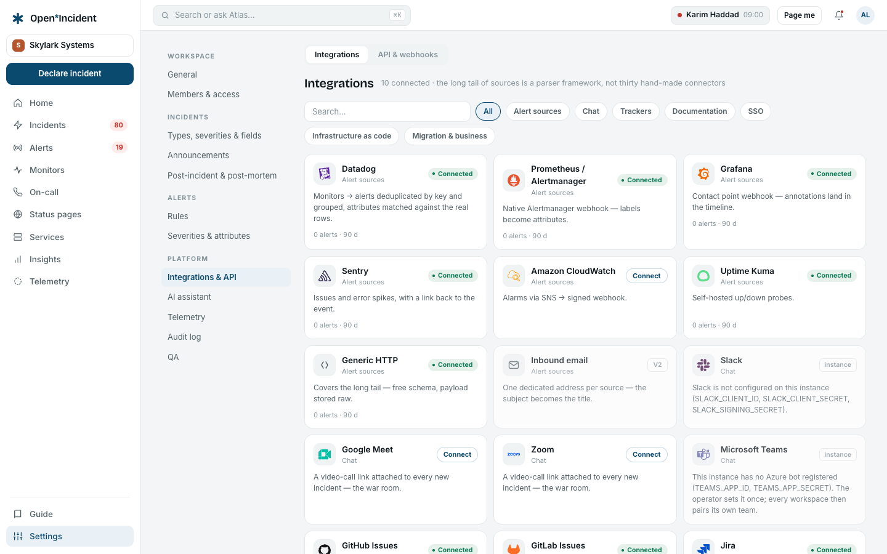
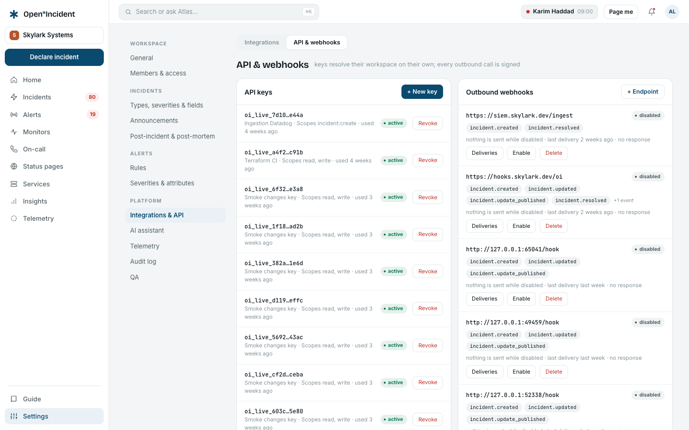
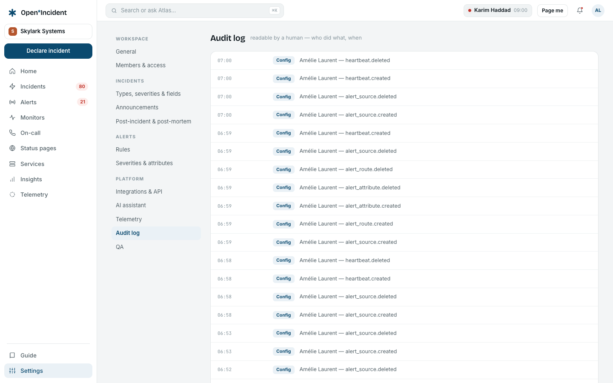

The **Platform** group holds one entry per screen: **Migrate from Opsgenie** (see [Operations](operations)), **Integrations**, **API & webhooks**, **Atlas** (see [The assistant](ai#governance)), **Telemetry**, **Audit log** and **Diagnostics**.

## Integrations

Slack and Microsoft Teams head the list with a line that opens their own page, **Slack & Teams** — where incident channels, pages in chat and commands are set. Filter chips by category, then **Connected** and **Available**: each tool in one row, a monochrome glyph, what it does, the account it is connected as. **Connect** opens a dialog with the tool's fields — credentials are tested before they are stored, and never shown again; **Manage** changes the settings without retyping the secret, syncs a tracker now, or disconnects. The Opsgenie row opens **Migrate from Opsgenie**; alert sources are created under Alerts.

One card per tool, filtered by category. **Alert sources** cards open the source screen; **Trackers** (GitHub Issues, GitLab Issues, Jira, Linear) and **Documentation** (Confluence, Notion) cards take credentials that are **tested before being saved**, encrypted at rest and never shown again; **Chat** cards (Slack, Microsoft Teams, and the war-room link template) run their own three-step flows; the **SSO** card points to the enterprise screens. A card whose instance-side prerequisite is missing says so — _Slack is not configured on this instance (SLACK_CLIENT_ID…)_ — rather than pretending.

Each integration has its own chapter: [Slack](slack), [Microsoft Teams](teams), [Trackers and documentation tools](trackers-docs).

## API & webhooks

### API keys

**+ New API key** asks for a name, the **access** (Read, or Read & write), the **scope** — Incidents; Incidents and monitors; Services; Status pages; Everything — and the **expiry** (30 days, 90 days, 1 year, never). The key is shown once, in the dialog. A key acts with the permissions of its scope, never more: outside its scope the API answers 403 `out_of_scope`, after its expiry 401 `key_expired`. A key that expires within 30 days is listed in the overview's _Needs your attention_; **Revoke** is immediate. **Try it** prints a curl on this workspace's address.

The **contract**: cursor pagination, 100 items at most, 600 requests per minute per key, errors always as `{ error: { code, message } }`, an OpenAPI document at `/api/v1/openapi.json`. See [API and automation](api).

### Webhook endpoints

**+ New endpoint** with an HTTPS URL and the **events** to subscribe to. The signing secret is shown once. Each delivery carries `x-oi-event`, `x-oi-timestamp` and `x-oi-signature: sha256=HMAC-SHA256(secret, body)`. Webhooks fire after the commit, never inside it: a slow receiver never slows an update. Failures are retried three times, then kept for a manual **Resend**; an endpoint failing for seven days is disabled. **Deliveries** lists every attempt with its status.

Each endpoint shows its last delivery — _200 · 4 min ago_, or the failure streak — and **Send test** delivers a test event now and says what the endpoint answered.

## Atlas

Described in [The assistant](ai#governance).

## Telemetry

How long the workspace keeps logs, traces and metrics, what is redacted before anything is written, the cardinality budget, and whether a bug that appears raises an alert on its own. Described in [Telemetry](telemetry).

## Audit log

Filter by area — Workspace, Members & access, Incidents, Alerts, Platform, **Atlas** — and **Export CSV** downloads the lines of the filter. Atlas's own lines are there in its words: an action it took alone and the service's level, a resolution, a level change, a cap set by an administrator. Lines are append-only: nobody, owners included, can edit or delete them.

Readable by a human: _Amélie invited karim@… as responder_, _Role of Karim: responder → Alerting admin_, _API key …a1f2 created (scope write)_, _Okta SSO sign-in — new session for sam@…_, _published v7 of the escalation path "Platform primary"_. Four categories — **Config**, **Security**, **Members**, **Data** — and a filter per category. Changes made through the API are attributed to the key's name; changes made by SCIM to _SCIM provisioning_.

Sensitive imports (status page subscribers, purge) are reserved to the owner and audited.

## Diagnostics

Owners only. The repository's own test suites — Playwright smoke, unit tests, typecheck, lint, format — run by the worker on the machine that hosts the instance. Each suite shows its last run (passed or failed, how many checks, how long, when) and opens its log; **Run** queues one suite, **Run all suites** queues them all. A suite already running cannot be started twice; a failed run is listed in the overview's _Needs your attention_.
