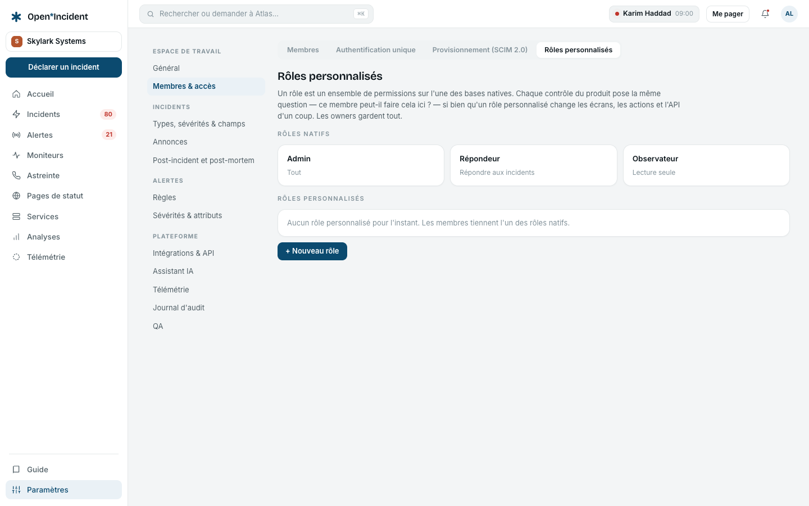

## The permission model

Every control in the product asks one question — _may this member do this here?_ — answered by eleven permissions:

| Permission           | Grants                                                               |
| -------------------- | -------------------------------------------------------------------- |
| `incidents.respond`  | Declare, update, assign, resolve incidents; act on alerts.           |
| `services.manage`    | Adopt a service, give it an owner, its owner's policy, its runbooks. |
| `oncall.manage`      | Schedules, rotations, overrides, escalation paths.                   |
| `statuspages.manage` | Status pages, components, maintenances.                              |
| `insights.manage`    | Pay reports and exports in Reports.                                  |
| `settings.workspace` | General & brand, working hours.                                      |
| `settings.members`   | Members, roles, single sign-on, provisioning.                        |
| `settings.response`  | Types & lifecycle, custom fields, announcements, post-incident flow. |
| `settings.alerting`  | Rules, alert severities, labels.                                     |
| `settings.platform`  | Integrations, API & webhooks, Atlas, telemetry, diagnostics.         |
| `audit.view`         | The audit log.                                                       |

The built-in roles are fixed sets: **Owner** and **Admin** hold everything; **Responder** holds `incidents.respond`; **Viewer** holds nothing and reads. Nothing changes for them.

> Roles saved by an older version may still carry two permissions that no longer exist, `catalog.entries` and `catalog.manage`. They grant nothing, the matrix does not show them, and the role's next save drops them.

## The matrix

**Settings › People & access › Roles** is one card. The custom roles sit at the top as chips, each with its member count; the selected one is in brand. Below, the **matrix**: a row per permission, a column per role — **Owner**, **Admin**, **Responder**, **Viewer**, read-only and in grey, then the selected custom role. Click a box in the last column to grant or withdraw that permission; the save bar appears, and **Save changes** applies the whole column at once — to the screens, the actions and the API.

**Edit** renames the selected role, rewords it or moves it to another base; **Delete** removes it. A role held by members cannot be deleted; the message names them — give them another role first.

## Creating a role

**+ New role**:

1. A **name** (_Alerting admin_, _Status page editor_, _Auditor_) and a description.
2. A **base role** — Responder, Viewer or Admin. It is what the member is shown as in the product, and what integrations without a permission model (a Slack command, for instance) fall back to. The new role starts with its base's permissions.
3. **Create the role**: it is selected in the matrix; tick the boxes it needs and save.

Then assign it from **Members**: the role select of a row lists the custom roles by name, and so does the role of an invitation.

## Examples

| Role               | Base      | Permissions                              | Who it is for                                                                          |
| ------------------ | --------- | ---------------------------------------- | -------------------------------------------------------------------------------------- |
| Alerting admin     | responder | `incidents.respond`, `settings.alerting` | The SRE who tunes the alert rules but should not touch members or integrations.        |
| Status page editor | viewer    | `statuspages.manage`                     | Support or communications: publishes and schedules maintenances, never runs incidents. |
| Auditor            | viewer    | `audit.view`                             | Compliance: reads the audit log, nothing else.                                         |
| On-call manager    | responder | `incidents.respond`, `oncall.manage`     | The team lead who owns the schedules and the escalation paths, and nothing else.       |

## What changes for a holder

- The **Settings** entry appears when the role holds any settings permission; the settings navigation and the overview show only the screens the role holds.
- On every screen, the controls that manage that area appear or disappear with the corresponding permission — the status page's components and maintenances with `statuspages.manage`, the on-call editing with `oncall.manage`…
- Server actions and API routes enforce the same permissions: a control that was hidden would be refused anyway.
- Without the `customRoles` entitlement, holders fall back to their base role.

## Owners

Owners keep everything and cannot be assigned a custom role through SCIM or demoted by it. Only an owner appoints another owner.
